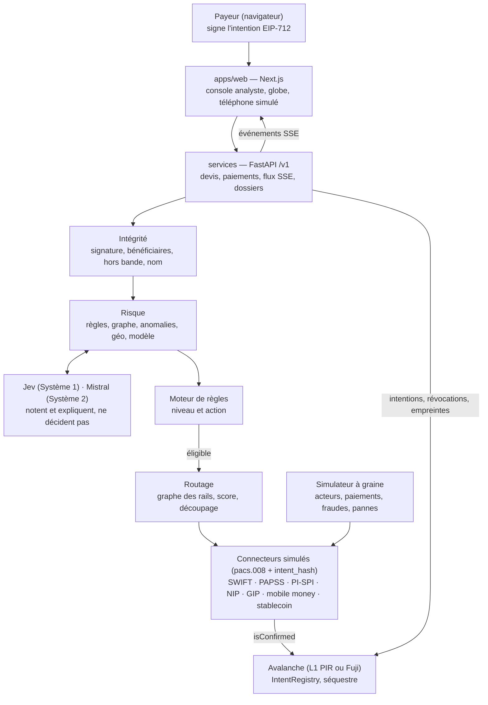

# PRD final — PIR · « L'aiguilleur » (nom à trancher)

> v2.0 · 10 octobre 2026 · Secure Horizons (ESSEC), Track 1 — Fintech Security.
> **Fusion de trois PRD** : _L'aiguilleur_ (Oscar, squelette et données terrain), notre _Payment Integrity Router_ v1.1 (couche intégrité, IA, chaîne, discipline d'ingénierie) et _Risk-Aware Payment Router_ (séparation des risques). Comparaison et arbitrages : [`comparaison-prd.md`](./comparaison-prd.md). Sources d'origine : [`prd-sources/`](./prd-sources/) et [`prd.md`](./prd.md) (v1.1, conservé pour l'historique).
> Priorités : **P0** = indispensable à la démo, jamais coupé · **P1** = prêt avant dimanche 6 h · **P2** = bonus / feuille de route.
> Accroche : _« La route la plus intelligente pour votre argent est celle qui arrive à bon port. »_

---

## 1. Résumé

L'aiguilleur est un routeur de paiements transfrontaliers pour l'Afrique de l'Ouest : pour chaque paiement, il choisit la route la moins chère et la plus rapide selon l'endroit où se trouvent l'émetteur et le bénéficiaire, **garantit que l'argent ne part que vers le bénéficiaire et le montant signés**, et retient la fraude avant que l'argent ne bouge.

- **Problème** : les paiements entre Lagos, Accra et Abidjan coûtent cher, passent souvent par un correspondant en dollars, et chaque institution ne voit que son tronçon : la fraude (faux fournisseur, mules, prise de contrôle) passe entre les trous.
- **Solution, en trois couches** : (1) **intégrité** — une intention de paiement signée, vérifiée par chaque connecteur de rail, et une vérification hors bande de tout nouveau compte avant la signature ; (2) **risque** — un moteur qui exploite la vue complète du réseau et les signaux géographiques ; (3) **réponse graduée** — route rapide, séquestre, retenue, blocage, avec le payeur et l'analyste dans la boucle. Tout est visible en direct sur un globe et vérifiable par un tiers sur Avalanche.
- **Périmètre** : triangle Lagos – Accra – Abidjan, trois monnaies (naira, cedi, franc CFA), sept rails simulés, 50 000 paiements synthétiques avec fraudes injectées, registre d'intentions et journal sur Avalanche.
- **Livrables (dimanche 11 octobre, 12 h)** : dépôt Git avec README, vidéo de démo 2–3 min, deck de 8 slides, fiche de défense, plan de réponse, slide conformité.

## 2. Principes directeurs

1. **L'intention signée est la source de vérité.** Aucune jambe ne s'exécute si elle ne correspond pas à l'intention (bénéficiaire, montant, devise, fenêtre, nonce).
2. **Deux risques, deux usages.** Le **risque de fraude de la transaction** décide si le paiement part et avec quelle action ; le **risque de route** (panne, intermédiaire peu fiable, connecteur compromis) ne sert qu'à choisir le rail. Changer de route ne rend jamais éligible un paiement suspect.
3. **Les modèles notent, les règles décident, l'humain tranche.** Une interdiction déterministe ne peut être levée par aucun modèle ; toute action lourde (blocage, déclaration) est validée par un humain.
4. **Échec sûr.** Sans Jev, sans Mistral ou sans chaîne, le système est plus strict, jamais plus laxiste ; un contrôle impossible retient le paiement.
5. **Vue complète, données minimales.** Pseudonymes, région plutôt que position, seules des métadonnées de flux sont partagées.
6. **Les textes d'un paiement sont des données, jamais des instructions** (facture, motif, `RmtInf`) : aucun modèle n'agit sur leur contenu.
7. **Honnêteté de la démo.** Tout rail simulé est étiqueté ; aucun chiffre affiché sans mesure ou source.

## 3. Problème terrain

| Friction              | Ce qu'on observe                                                                                                                                                                                                            | Source                                                                                                                                                                                                                                                                                                                                                                                                                                     |
| --------------------- | --------------------------------------------------------------------------------------------------------------------------------------------------------------------------------------------------------------------------- | ------------------------------------------------------------------------------------------------------------------------------------------------------------------------------------------------------------------------------------------------------------------------------------------------------------------------------------------------------------------------------------------------------------------------------------------ |
| Coût                  | Envoyer 200 $ vers l'Afrique subsaharienne coûte 8,46 % en moyenne (T3 2025), contre 6,36 % dans le monde, et 14,99 % via une banque                                                                                        | [Banque mondiale](https://remittanceprices.worldbank.org/sites/default/files/2026-04/RPW_main_report_and_annex_Q325.pdf)                                                                                                                                                                                                                                                                                                                   |
| Détour                | Plus de 80 % des paiements transfrontaliers africains passeraient par des correspondants aux États-Unis ou en Europe (estimation non attribuée), +2 à 5 % par opération                                                     | [TechCabal](https://techcabal.com/2026/03/31/how-papss-is-meeting-cross-border-promise-four-years-on/)                                                                                                                                                                                                                                                                                                                                     |
| Lenteur               | En Afrique, ≈ 25 % des paiements SWIFT arrivent en moins d'une heure ; 35,4 % dans le monde, 75 % visés par le G20 pour 2027                                                                                                | [Swift](https://www.swift.com/insights/news/insights-african-payments-landscape) · [FXC Intelligence](https://www.fxcintel.com/research/reports/ct-retail-payments-g20-cross-border-roadmap-2025)                                                                                                                                                                                                                                          |
| Îlots                 | PI-SPI relie 175 participants dans les 8 pays de l'UEMOA, pas le Nigeria ni le Ghana. PAPSS couvre 28 pays, pas encore la Côte d'Ivoire (pilote UEMOA annoncé sans date)                                                    | [BCEAO](https://www.bceao.int/sites/default/files/2026-10/Communiqu%C3%A9%20du%202%20octobre%202026.pdf) · [Launch Base](https://launchbaseafrica.com/2026/07/09/papss-inches-closer-to-continent-wide-coverage-as-central-african-central-bank-joins/) · [Ecofin](https://www.ecofinagency.com/news-finances/2107-57583-bceao-prepares-papss-pilot-with-more-than-80-west-african-banks)                                                  |
| Plafonds              | Fixés banque par banque : chez FBN Ghana, 2 000 $ par jour pour un particulier sur PAPSS                                                                                                                                    | [FBN Ghana](https://www.fbnbankghana.com/?p=26359)                                                                                                                                                                                                                                                                                                                                                                                         |
| Géographie            | Les francs CFA d'Afrique de l'Ouest et centrale ont la même parité avec l'euro mais ne sont pas interchangeables ; la bonne route dépend de la région du bénéficiaire (compte en ville, portefeuille mobile en zone rurale) | [Banque de France](https://banque-france.fr/system/files/2024-08/zone-franc.pdf)                                                                                                                                                                                                                                                                                                                                                           |
| Fraude                | Nigeria : 25,85 Md₦ de pertes en 2025 (67 518 cas, 63 % à Lagos). Ghana : 16 733 cas en 2024, dont 94 % chez les prestataires de paiement. Côte d'Ivoire : 12 100 affaires, ≈ 6,96 Md FCFA de préjudice en 2024             | [NIBSS](https://nibss-plc.com.ng/nibss-digital-payment-fraud-drops-51-to-%E2%82%A625-85b-in-2025/) · [Banque du Ghana](https://gab.com.gh/assets/images/docs/Overview%20of%20BoG%20Fraud%20Report_UPDATED%20APRIL%202025.pdf) · [KOACI](https://www.koaci.com/article/2025/05/27/cote-divoire/societe/cote-divoire-cybercriminalite-la-plcc-a-enregistre-12100-affaires-en-2024-pour-un-prejudice-de-pres-de-7-milliards-fcfa_187200.html) |
| Faux fournisseur      | Le GIABA classe la messagerie compromise parmi les typologies régionales de blanchiment lié à la cybercriminalité ; ordre de grandeur mondial : 3,05 Md$ de pertes BEC aux États-Unis en 2025 (FBI IC3, voir `projet.md`)   | [Droit Médias Finance](https://droitmediasfinance.com/index.php/actualites/droit-tech-fintech/1006-lutte-anti-blanchiment-cybersecurite-le-giaba-rapporte-sur-7-types-de-blanchiment-de-capitaux-lies-a-la-cybercriminalite-en-afrique-de-louest)                                                                                                                                                                                          |
| Visibilité fragmentée | Chaque institution ne voit qu'un tronçon : un réseau de mules qui traverse plusieurs institutions n'est visible d'aucune isolément                                                                                          | _(analyse, PRD A)_                                                                                                                                                                                                                                                                                                                                                                                                                         |

Question ouverte : aucune donnée publique sur la liquidité des agents de retrait par région ; hypothèse simulée, à dire au jury.

## 4. Utilisateurs et personas

Le client payant est la fintech qui émet les paiements ; l'utilisateur quotidien de la console est son analyste fraude et conformité ; le payeur reste maître de son intention.

| Persona                                                 | Qui                                                         | Ce qu'il veut                                                             | Ce que le produit lui apporte                                                                        |
| ------------------------------------------------------- | ----------------------------------------------------------- | ------------------------------------------------------------------------- | ---------------------------------------------------------------------------------------------------- |
| Fintech émettrice                                       | Plateforme de paiement B2B, société de transfert, néobanque | Moins de frais, plus de paiements aboutis, une seule intégration          | API qui note les routes, choisit la meilleure, contrôles inclus                                      |
| **Analyste fraude et conformité**                       | Équipe risque de la fintech                                 | Moins d'alertes inutiles, dossiers complets, déclarations dans les délais | File d'alertes expliquées, chronologie et tracé sur le globe, déclaration pré-remplie                |
| **Adaeze, DAF d'une PME importatrice à Lagos** (payeur) | Crée et signe l'intention, confirme ou annule les retenues  | Prix connu d'avance, délai fiable, ne pas se faire piéger                 | Devis comparé au détour par le dollar ; alerte hors bande sur son téléphone avant que l'argent parte |
| Second approbateur                                      | Co-signe au-delà du seuil                                   | Garder le contrôle sans tout relire                                       | Double contrôle seulement au-delà du seuil                                                           |
| **Koffi, fournisseur à Abidjan** (bénéficiaire urbain)  | Reçoit, répond à la vérification hors bande                 | Être payé vite, nom vérifié                                               | Crédit instantané via PI-SPI, lien de suivi sans détails de sécurité                                 |
| Famille à Tamale (bénéficiaire rural, nord du Ghana)    | Retire l'argent                                             | Retirer près de chez elle                                                 | Livraison sur le portefeuille de l'opérateur présent dans sa région                                  |
| Auditeur / régulateur                                   | Vérifie a posteriori                                        | Rejouer une décision, prouver qu'elle n'a pas été réécrite                | Journal hash-chaîné, empreintes et intentions sur Avalanche, versions des règles et du modèle        |
| Ops                                                     | Supervise rails et connecteurs                              | Couper un rail ou un connecteur compromis                                 | État des rails, kill switch, mode dégradé                                                            |

## 5. Objectifs, non-objectifs et indicateurs

**Objectifs** : (1) battre le détour par le dollar sur le coût et le délai dans le triangle ; (2) **zéro détournement** : aucun paiement exécuté vers un bénéficiaire ou un montant différent de l'intention signée ; (3) détecter les fraudes injectées avant exécution, avec un gain mesuré dû à la vue complète et aux signaux géographiques ; (4) répondre de façon graduée, tracée et vérifiable par un tiers.

**Non-objectifs** : aucune connexion à un vrai rail ni donnée réelle (règlement du hackathon) ; aucune détention de fonds, aucune vérification d'identité réelle, aucune application grand public ; aucun corridor hors du triangle.

| Indicateur                                   | Objectif interne                                                  | Référence                             | Critère du jury      |
| -------------------------------------------- | ----------------------------------------------------------------- | ------------------------------------- | -------------------- |
| Taux de détournement                         | **0** sur le jeu d'attaque (substitution, rejeu, montant modifié) | —                                     | Détection (30 %)     |
| Rappel par typologie de fraude               | ≥ 85 %                                                            | Objectif d'équipe                     | Détection            |
| Faux positifs sur paiements honnêtes         | ≤ 2 %                                                             | Objectif d'équipe                     | Détection            |
| Gain dû à la vue complète et à la géographie | Écart de rappel à faux positifs égaux                             | Institution isolée ; sans signaux géo | Détection            |
| Délai de détection d'une campagne            | Temps entre le premier acte et la première alerte                 | Institution isolée                    | Détection            |
| Fraudes stoppées avant exécution             | 100 % des fraudes détectées                                       | —                                     | Réponse (20 %)       |
| Coût tout compris (frais + écart de change)  | ≤ 1 % au-delà de 200 $                                            | Cible G20 ; 8,46 % aujourd'hui        | Faisabilité (20 %)   |
| Part créditée en moins d'une heure           | ≥ 75 %                                                            | Cible G20 ; 35,4 % dans le monde      | Faisabilité          |
| Part utilisable sur place                    | ≥ 95 %                                                            | Indicateur propre                     | Réponse              |
| Latence de décision                          | p95 < 300 ms hors Jev et chaîne ; < 1 s aux 2 points Jev          | —                                     | Faisabilité          |
| Paiements légitimes sans intervention (STP)  | > 90 %                                                            | —                                     | Réponse              |
| Décisions rejouables par un auditeur         | 100 %                                                             | Journal + Avalanche                   | Conformité (15 %)    |
| Délai d'affichage                            | < 1 s entre un événement et son tracé                             | —                                     | Pitch et démo (15 %) |

Les KPI coût et délai sont **illustratifs** (rails simulés) ; seuls les KPI de sécurité sont réellement mesurés sur le jeu.

## 6. Scénario de démo (3 min)

Fil rouge : **le faux fournisseur**, de l'alerte à la réponse (conseil des organisateurs : un scénario traité parfaitement). Les autres scènes prouvent la route et la vue complète.

| Temps | Scène                                                                                                                                                                                                                                                                                                                                                                                                     | Ce que voit le jury                                                                    |
| ----- | --------------------------------------------------------------------------------------------------------------------------------------------------------------------------------------------------------------------------------------------------------------------------------------------------------------------------------------------------------------------------------------------------------- | -------------------------------------------------------------------------------------- |
| 0:00  | **Le globe** tourne avec tout le réseau, correspondants de New York, Londres et Paris compris, puis plonge sur Lagos, Accra, Tamale et Abidjan                                                                                                                                                                                                                                                            | Le détour par le dollar évité ; un chiffre : 8,46 %                                    |
| 0:15  | **Paiement fournisseur** : Adaeze paie 3 000 $ à Koffi (Abidjan). PAPSS ne relie pas la Côte d'Ivoire, le rail stablecoin est désactivé en UEMOA : la route retenue passe par le hub mobile money puis PI-SPI ; le devis explique pourquoi                                                                                                                                                                | Une seule route tracée saut par saut, coût et délai, intention publiée (lien explorer) |
| 0:40  | **Paiement familial** : 150 $ vers Tamale ; la route change pour le portefeuille de l'opérateur présent dans la région                                                                                                                                                                                                                                                                                    | La géographie change la route                                                          |
| 0:55  | **Panne** : le rail instantané ghanéen tombe ; les paiements suivants se reroutent — **risque de route**                                                                                                                                                                                                                                                                                                  | Rail en pointillés rouges, reroutage immédiat                                          |
| 1:10  | **Faux fournisseur** : un PDF reçu par e-mail annonce un nouveau compte pour Koffi, créé la veille, nom du titulaire ≠ facture. **Avant la signature** : vérification hors bande exigée ; risque élevé (règles, graphe, Jev « facture de type faux fournisseur ? » 0,9) → **retenu** ; Mistral explique en 3 lignes ; le téléphone d'Adaeze sonne, elle appelle le numéro **déjà connu** de Koffi, annule | Cadenas avant le dernier saut, explication, action humaine                             |
| 1:50  | **Substitution en transit** : un connecteur compromis tente d'envoyer une jambe signée vers un autre compte → refus (`intent_hash` ≠) → kill switch du connecteur, révocation inscrite on-chain                                                                                                                                                                                                           | Refus journalisé, événement `Revoked` sur l'explorer                                   |
| 2:10  | **Réseau de mules** : 40 victimes au Ghana paient vers des portefeuilles vidés en quelques minutes près d'une frontière ; la grappe s'allume, paiements retenus, coupe-circuit régional, déclaration FIC pré-remplie, l'analyste valide                                                                                                                                                                   | Ce qu'aucune institution isolée ne voit                                                |
| 2:35  | **Le bilan** sur la graine B : coût, < 1 h, utilisable sur place, rappel / faux positifs avec et sans vue complète, 0 détournement, montant retenu                                                                                                                                                                                                                                                        | Les chiffres mesurés                                                                   |

Délai entre pays voisins via correspondant : 3 à 7 jours ouvrés ([Kora](https://www.korahq.com/blog/the-hidden-payment-problem-slowing-intra-african-trade)).

## 7. Exigences fonctionnelles

14 modules P0 ; chaque P0 a un critère d'acceptation (CA) testable.

| ID  | Module                                        | Exigence et critères d'acceptation                                                                                                                                                                                                                                                                                                                                                                                                                                  | Prio |
| --- | --------------------------------------------- | ------------------------------------------------------------------------------------------------------------------------------------------------------------------------------------------------------------------------------------------------------------------------------------------------------------------------------------------------------------------------------------------------------------------------------------------------------------------- | ---- |
| F1  | Registre des rails et profils pays            | Institutions, rails, régions : coûts, délais p50 / p95, plafonds, horaires UTC, couverture, état en direct. Un **profil pays déclaratif** (un fichier) porte rails autorisés, plafonds, exigences déclaratives, `allow_stablecoin`. CA : un rail interdit pour (pays, devise, montant) n'apparaît pas dans le graphe                                                                                                                                                | P0   |
| F2  | Intention signée                              | `PaymentIntent` (payeur, bénéficiaire, compte, montant, devise, échéance, `invoice_hash`, provenance par champ, contraintes coût max / date limite) signée EIP-712 dans le navigateur (`packages/core`) ; `intent_hash` affiché ; toute modification crée une nouvelle intention. CA : signature vérifiée côté serveur, vecteur de test commun TS / Python / Solidity                                                                                               | P0   |
| F3  | Bénéficiaires vérifiés et vérification du nom | Registre (`first_seen`, paiements réussis, preuves) ; tout nouveau compte issu d'un document non fiable exige une **vérification hors bande** sur un contact déjà enregistré (jamais celui de la facture) **avant** la signature — signature bloquée, pas seulement avertie ; time-lock au premier paiement ; comparaison nom attendu / nom du titulaire (`/v1/name-check`) ; double contrôle au-delà du seuil. CA : scène faux fournisseur bloquée avant signature | P0   |
| F4  | Devis et routage                              | Une seule route, la meilleure, avec sa raison en une ligne ; alternatives et scores au journal ; horaires et fuseaux ; devis 600 s ; reroutage en cas de panne (§8). CA : ≤ 2 s ; reroutage visible                                                                                                                                                                                                                                                                 | P0   |
| F5  | Connecteurs et format pivot                   | Un connecteur simulé par rail (`quote`, `initiate`, `status`, `onWebhook`), format pivot pacs.008 avec UETR ; **avant `initiate`, chaque connecteur vérifie** `intent_hash`, fenêtre, nonce non consommé, intention non révoquée ; idempotence. CA : test automatisé de refus par connecteur (substitution, rejeu, montant)                                                                                                                                         | P0   |
| F6  | Moteur de risque                              | Score de fraude 0–100 par paiement avant exécution, < 300 ms : règles, graphe des flux, anomalies, signaux géographiques, modèle supervisé (§9) ; 3 signaux les plus forts par alerte                                                                                                                                                                                                                                                                               | P0   |
| F7  | Juge sémantique (Jev)                         | 2 questions P0 à la signature : « facture de type faux fournisseur ? », « cohérent avec l'historique du couple ? » ; une question par appel, appels en parallèle, cache par hash des champs normalisés, quota respecté ; réponse = probabilité. CA : p95 < 1 s ; désaccord modèle / Jev > 0,4 → au moins « élevé »                                                                                                                                                  | P0   |
| F8  | Réponse graduée                               | 4 niveaux (§10), moteur de règles déterministe ; **téléphone simulé** du payeur pour la confirmation hors bande ; kill switch par connecteur ou route ; coupe-circuit par région ou corridor. CA : chaque niveau démontré sur le jeu                                                                                                                                                                                                                                | P0   |
| F9  | Console analyste                              | File d'alertes, dossier avec chronologie, tracé sur le globe, preuves, actions libérer / retenir / bloquer / déclarer ; **explication Mistral** ≤ 120 mots (jamais d'action ; repli = règles + 3 signaux après 10 s)                                                                                                                                                                                                                                                | P0   |
| F10 | Globe en direct et fil texte                  | Institutions, rails, route retenue saut par saut, couleur selon le niveau, alertes géographiques ; piloté uniquement par le flux d'événements (§11) ; fil texte toujours affiché. CA : < 1 s, 60 i/s, ≤ 200 arcs animés                                                                                                                                                                                                                                             | P0   |
| F11 | Simulateur à graine                           | Acteurs, paiements, fraudes, pannes rejouables à partir d'une graine ; injection d'événements pour la démo (`/v1/sim/events`) ; horloge de démo pilotable                                                                                                                                                                                                                                                                                                           | P0   |
| F12 | Journal et registre de confirmation           | Journal hash-chaîné (qui, quoi, preuve, règle, score, version des règles et du modèle) avec vérification d'altération ; `IntentRegistry` (déjà codé) : publication des intentions (hashes seulement), révocations, empreintes de décisions ; écriture asynchrone, lecture avant le règlement par le connecteur PI-SPI simulé ; lien explorer dans la chronologie                                                                                                    | P0   |
| F13 | Évaluation                                    | Protocole graine A / graine B, 3 références, ablations (§13) ; un script reproduit tous les chiffres du pitch                                                                                                                                                                                                                                                                                                                                                       | P0   |
| F14 | Fondations                                    | Utilisateurs préconfigurés par rôle (payeur, approbateur, analyste, ops, auditeur) ; fixtures (Adaeze, Koffi connu avec 12 paiements, faux compte, famille de Tamale, 3 factures dont la frauduleuse) ; `seed` idempotent                                                                                                                                                                                                                                           | P0   |
| F15 | Séquestre on-chain                            | `TradeEscrow` existant pour le niveau moyen : libéré quand le bénéficiaire confirme depuis la région attendue, remboursé à expiration                                                                                                                                                                                                                                                                                                                               | P1   |
| F16 | Déclaration de soupçon                        | Brouillon pré-rempli pour la cellule du pays (NFIU, FIC, CENTIF) avec compte à rebours                                                                                                                                                                                                                                                                                                                                                                              | P1   |
| F17 | Découpage                                     | Flot à coût minimal si plafond ou liquidité l'impose ; chaque fraction porte le même `intent_hash`, étiquetée « technique »                                                                                                                                                                                                                                                                                                                                         | P1   |
| F18 | Extraction de facture                         | Extraction automatique (intake existant) avec confiance par champ ; repli : factures de démo pré-extraites                                                                                                                                                                                                                                                                                                                                                          | P1   |
| F19 | L1 PIR dédiée                                 | `IntentRegistry` sur la L1 PIR (Avalanche, avis du mentor) ; décision L1 ou Fuji prise dimanche 0 h ; bascule par configuration                                                                                                                                                                                                                                                                                                                                     | P1   |
| F20 | Ajouter un pays en un fichier                 | Profil Sénégal ou Bénin ajouté en direct, sans code                                                                                                                                                                                                                                                                                                                                                                                                                 | P1   |
| F21 | Mode dégradé                                  | Jev, Mistral ou chaîne indisponibles → règles + modèles + humain, bandeau ; aucun déblocage par défaut                                                                                                                                                                                                                                                                                                                                                              | P1   |
| —   | Bonus                                         | Jambe stablecoin eERC avec clé auditeur (partiel sur branche), attestation de bénéficiaire EIP-712, VC KYB, Travel Rule IVMS101, honeytokens, prédicteurs en ligne, mode ombre pour PSP, information fiscale                                                                                                                                                                                                                                                        | P2   |

## 8. Spécification du routage

Le routage n'est appelé que pour un paiement **éligible** (niveau faible, ou moyen avec séquestre). Chaque route reçoit un score ; le plus bas gagne et seule cette route est renvoyée.

**Graphe** : nœuds = couple institution × région (monnaie, coordonnées GeoNames / Natural Earth) ; arêtes = rails (frais fixes et en %, écart de change, délai p50 et p95, plafonds par opération et par jour, horaires UTC, justificatifs, état ouvert / congestionné / en panne).

```math
S(r, p) = C(r) + \lambda \, T(r) + \mu \, K \, P_{\mathrm{echec}}(r) + \nu \, K \, P_{\mathrm{inutil}}(r) + \sigma \, R_{\mathrm{route}}(r)
```

- C : coût tout compris en % du montant ; T : délai attendu en heures (heures limites et fuseaux compris) ; P échec : plafond, liquidité, justificatif ; K : coût d'un échec ; P inutil : argent non utilisable dans la région du bénéficiaire ; λ, μ, ν, σ réglables par client.
- **R route** : risque _opérationnel ou de sécurité du rail_ (taux d'échec anormal, intermédiaire peu fiable, connecteur sous kill switch). **Le risque de fraude de la transaction n'entre pas dans S** (principe 2) : il fixe l'action (§10) et peut seulement restreindre l'ensemble des routes (niveau moyen → routes avec séquestre ou rappel possible).

**Algorithme** : (1) filtrer rails fermés, en panne, hors plafond, interdits dans le pays (stablecoin en UEMOA) ou sous kill switch ; (2) 5 meilleurs chemins par l'algorithme de Yen (`networkx.shortest_simple_paths`) ; (3) noter avec S, renvoyer le meilleur et sa raison, journaliser les autres ; (4) si plafond ou liquidité l'imposent, découper (P1) avec le CVXPY existant (repli OR-Tools `SimpleMinCostFlow`, poids entiers) ; (5) devis valable 600 s, comme Nexus ; (6) jambe fermée → planifiée à l'ouverture.

**Règles géographiques** : rester dans la zone monétaire quand c'est possible (Abidjan → Dakar par PI-SPI sans change) ; euro comme pont du franc CFA à 655,957 FCFA ; livrer sur le rail présent dans la région du bénéficiaire, pondéré par un indice de liquidité des agents (hypothèse simulée) ; fuseaux (Lagos UTC+1, Accra et Abidjan UTC+0), règlement net PAPSS à 11 h UTC ; PAPSS fermé vers la Côte d'Ivoire tant que le pilote n'est pas ouvert (interrupteur de démo) ; reroutage dès qu'un rail tombe, retour quand il revient.

Sources : [Nexus](https://docs.nexusglobalpayments.org/fx-provision/quotes.md) · [networkx](https://networkx.org/documentation/stable/reference/algorithms/generated/networkx.algorithms.simple_paths.shortest_simple_paths.html) · [OR-Tools](https://developers.google.com/optimization/flow/mincostflow) · [Trésor](https://www.tresor.economie.gouv.fr/tresor-international/la-zone-franc/les-principes-et-modalites-de-fonctionnement-de-la-cooperation-monetaire) · [PAPSS](https://papss.com/how-it-works/)

## 9. Spécification du risque de fraude

La décision suit trois étages, dans cet ordre :

1. **Intégrité (déterministe, < 5 ms)** : intention signée, bénéficiaire vérifié ou non, provenance des champs, nom du titulaire, sanctions (liste synthétique), plafonds, time-lock, double contrôle. Une interdiction ici est définitive.
2. **Score de fraude 0–100 (< 300 ms)** : règles, indicateurs de graphe (entrées / sorties multiples, cycles courts `networkx.simple_cycles`, temps de passage), anomalies (IsolationForest ou PyOD), modèle supervisé (gradient boosting, entraîné sur la graine A, testé sur la graine B), signaux géographiques.
3. **Jev (sémantique, à la signature)** : il lit la facture et le contexte ; le modèle juge le comportement, Jev la sémantique — leur désaccord est informatif.

| Typologie                        | Signaux principaux                                                                                      | Source                                                                                                                                                                                                                             |
| -------------------------------- | ------------------------------------------------------------------------------------------------------- | ---------------------------------------------------------------------------------------------------------------------------------------------------------------------------------------------------------------------------------- |
| **Faux fournisseur** (fil rouge) | Compte créé ou modifié récemment, provenance « PDF par e-mail », nom ≠ facture, domaine proche, urgence | [GIABA](https://droitmediasfinance.com/index.php/actualites/droit-tech-fintech/1006-lutte-anti-blanchiment-cybersecurite-le-giaba-rapporte-sur-7-types-de-blanchiment-de-capitaux-lies-a-la-cybercriminalite-en-afrique-de-louest) |
| **Substitution en transit**      | Jambe ≠ intention, nonce déjà consommé, intention révoquée                                              | Empêchée par F5, pas seulement détectée                                                                                                                                                                                            |
| Réseau de comptes mules          | Afflux multi-pays vers un portefeuille, vidage en minutes, retraits chez peu d'agents                   | [GAFI](https://www.fatf-gafi.org/content/dam/fatf-gafi/reports/Illicit-financial-flows-cyber-enabled-fraud.pdf.coredownload.inline.pdf)                                                                                            |
| Fractionnement sous les seuils   | Montants répétés juste sous un plafond, sur plusieurs comptes                                           | [FIC Ghana](https://fic.gov.gh/images/2026/Advisory_Notice_-_1.pdf)                                                                                                                                                                |
| Prise de contrôle et SIM swap    | SIM changée récemment, appareil ou pays inhabituel, déplacement impossible                              | [GSMA](https://www.gsma.com/mobilefordevelopment/wp-content/uploads/2024/03/GSMA-Fraud-Typologies-04-03-24.pdf)                                                                                                                    |
| Victime d'arnaque                | Premier envoi vers ce corridor, montant inhabituel, bénéficiaire signalé                                | [Interpol](https://www.interpol.int/News-and-Events/News/2025/African-authorities-dismantle-massive-cybercrime-and-fraud-networks-recover-millions)                                                                                |
| Collusion d'agent (P1)           | Dépôts découpés près des paliers de commission                                                          | [arXiv 1910.05596](https://arxiv.org/pdf/1910.05596)                                                                                                                                                                               |

**Signaux géographiques** : distance appareil / compte (région) ; déplacement impossible (> 900 km/h) ; portefeuille ouvert dans une région et vidé dans une autre ; retraits d'une grappe concentrés près d'une frontière ; vague de fraude en cours dans le corridor.

**Seuils** (réglables) : 0–39 faible, 40–69 moyen, 70–89 élevé, 90–100 critique. Désaccord modèle / Jev > 0,4 → au moins élevé. Budget d'alertes : 3 % des légitimes sur 30 jours ; un ajustement ne touche que la zone grise, jamais une règle.

## 10. Plan de réponse (livrable « playbook »)

| Niveau                       | Action automatique                                                                                                                                       | Action humaine                                                       | Délai                                                                                    |
| ---------------------------- | -------------------------------------------------------------------------------------------------------------------------------------------------------- | -------------------------------------------------------------------- | ---------------------------------------------------------------------------------------- |
| Faible (0–39)                | Meilleure route                                                                                                                                          | Aucune                                                               | Immédiat                                                                                 |
| Moyen (40–69)                | Vérification du nom, données complètes émetteur / bénéficiaire, **séquestre** libéré quand le bénéficiaire confirme depuis la région attendue            | Analyste alerté si le séquestre dépasse 2 h                          | 2 h (objectif d'équipe)                                                                  |
| Élevé (70–89)                | **Retenue avant exécution** ; confirmation demandée au **payeur sur un canal hors bande** (téléphone simulé, jamais l'e-mail) avec l'explication Mistral | Le payeur confirme ou annule ; l'analyste libère, prolonge ou bloque | 2 h ouvrées ; expiration 72 h → annulation                                               |
| Critique (90–100)            | Blocage, dossier et déclaration de soupçon pré-remplis                                                                                                   | L'analyste valide et transmet à la cellule                           | Nigeria et Ghana : 24 h ; Côte d'Ivoire : avant exécution, confirmation écrite sous 48 h |
| Connecteur ou rail compromis | **Kill switch** du connecteur, **révocation** inscrite on-chain, reroutage des paiements sains                                                           | Ops réactive                                                         | Immédiat                                                                                 |

**Coupe-circuit régional** : quand une grappe touche une région ou un corridor, les seuils y baissent de 20 points pendant 24 h ; seul un humain le lève plus tôt.

**Qui est prévenu** : l'analyste (console) ; le payeur (hors bande, niveaux moyen et élevé) ; l'institution destinataire (alerte portant l'UETR) ; la cellule de renseignement financier, uniquement par l'analyste ; **jamais le client visé par une déclaration** (interdit par la loi ivoirienne).

**Trace** : chaque action est horodatée, rattachée aux versions des règles et du modèle, chaînée dans le journal, et son empreinte est écrite sur Avalanche.

## 11. Expérience : le paiement tracé en direct

Le globe ne calcule rien : il dessine les événements publiés par l'API, chacun avec l'UETR, l'heure et les coordonnées des institutions.

| Événement                                                             | Ce que fait le globe                                           |
| --------------------------------------------------------------------- | -------------------------------------------------------------- |
| `intent.signed`, `intent.published`                                   | Badge « signé », lien explorer                                 |
| `route.selected`                                                      | Dessine la seule route retenue, saut par saut                  |
| `risk.scored`                                                         | Affiche le score, colore le tracé (vert, ambre, orange, rouge) |
| `hop.sent`, `hop.settled`                                             | Comète sur le saut, onde à l'institution atteinte              |
| `leg.rejected`                                                        | Croix rouge sur le connecteur (substitution refusée)           |
| `escrow.locked`, `escrow.released`                                    | Cadenas avant le dernier saut, puis ouverture                  |
| `payment.held`, `payment.blocked`                                     | Fige le tracé en orange ou rouge, ouvre le dossier             |
| `payment.credited`                                                    | Onde verte chez le bénéficiaire, bilan coût, délai, économie   |
| `alert.raised`                                                        | Anneaux, grappe ou déplacement impossible sur la région        |
| `rail.down`, `rail.up`, `breaker.on`, `breaker.off`, `intent.revoked` | Rail en pointillés rouges, région teintée, révocation          |

**P0** : réseau (`pointsData`, `labelsData`, `arcsData`), route retenue et comète, couleur de risque, anneaux d'alerte, rail en panne, fil texte. **P1** : trafic de fond, hexagones de grappe, polygones de coupe-circuit, arc stablecoin surélevé, horloge accélérée.

**Règles** : une seule route visible par paiement ; régions et institutions seulement, jamais la position d'une personne ; au-delà de 10 s, temps accéléré avec horloge du délai réel simulé.

**Technique** : react-globe.gl 2.38 chargé dans un composant client (`next/dynamic`, `ssr: false`) ; un seul flux SSE pour toute la console (limite de 6 connexions par domaine en HTTP/1.1), `id` par événement pour la reprise ; textures et frontières servies en local ; plan B : vidéo enregistrée samedi soir et fil texte sans WebGL.

## 12. Architecture technique



| Composant                                    | Technologie                                                                                                 | Existant dans le dépôt                                                    |
| -------------------------------------------- | ----------------------------------------------------------------------------------------------------------- | ------------------------------------------------------------------------- |
| Console, globe, signature                    | Next.js, TypeScript, Tailwind, react-globe.gl, viem                                                         | `apps/web` (DA, i18n, composants)                                         |
| Types, `intentHash`, EIP-712                 | `packages/core`                                                                                             | branche `core-package` (test croisé Foundry)                              |
| API, routage, risque, simulateur, évaluation | Python 3.12, FastAPI (SSE natif), networkx, CVXPY, scikit-learn, PyOD, `eth_account` (vérification EIP-712) | `services/sor` (SOR CVXPY, FastAPI)                                       |
| Stockage                                     | Supabase / Postgres local                                                                                   | `supabase/`                                                               |
| Contrats                                     | Solidity, Foundry, OpenZeppelin 5.x                                                                         | `IntentRegistry` (branche), `TradeEscrow` (main), eERC (branche, partiel) |
| Chaîne                                       | L1 PIR (Subnet-EVM, chainId 7810, script `infra/avalanche/l1-local.sh`) ou Fuji (43113)                     | branche `avalanche-l1-locale`                                             |
| IA                                           | Jev `openjev-latest` via Codiv ; Mistral                                                                    | clés dans `apps/web/.env.local`                                           |

**Point de vigilance** : `intent_hash` doit être identique en TypeScript, Python et Solidity → EIP-712 (standard) et **un vecteur de test commun** dans les trois suites dès samedi soir.

## 13. Modèle de données et API

| Entité                 | Champs clés                                                                                                                                                                   |
| ---------------------- | ----------------------------------------------------------------------------------------------------------------------------------------------------------------------------- |
| Institution            | id, nom, type (banque, monnaie électronique, mobile money, rampe stablecoin), pays, régions, BIC ou code local                                                                |
| Rail                   | id, type, monnaies, frais, écart de change, délai p50 / p95, plafonds, horaires UTC, justificatifs, état, pays autorisés                                                      |
| Région                 | id, pays, coordonnées, opérateur dominant, indice de liquidité des agents (simulé)                                                                                            |
| PaymentIntent          | payeur, bénéficiaire (réf. registre), compte, montant, devise, échéance, `invoice_hash`, provenance par champ, contraintes, signature(s), `intent_hash`, nonce, `valid_until` |
| Bénéficiaire / compte  | identifiants, `first_seen`, paiements réussis, preuves, statut de vérification hors bande                                                                                     |
| Paiement               | uetr (UUID v4), `intent_hash`, régions, route choisie, score, niveau, statut                                                                                                  |
| Étape (PaymentLeg)     | uetr, `intent_hash`, nonce, rail, rang, institutions, horodatages, statut                                                                                                     |
| Dossier                | id, paiements liés, typologie, score, signaux, réponses Jev, explication, actions, décision humaine                                                                           |
| Décision / LedgerEvent | id, uetr, versions des règles et du modèle, empreinte des preuves, hash précédent, transaction on-chain                                                                       |

**Format pivot** (sous-ensemble pacs.008.001.08) : `UETR` obligatoire et inchangé, `Dbtr`, `DbtrAgt`, `Cdtr`, `CdtrAgt`, `IntrmyAgt1`, `InstdAmt`, `XchgRate`, `ChrgBr`, `Purp`, `RmtInf/Ustrd` (≤ 140 caractères), adresses structurées ; **`intent_hash` et nonce en `SplmtryData`**.

| Méthode et route                               | Rôle                                                                                 |
| ---------------------------------------------- | ------------------------------------------------------------------------------------ |
| `POST /v1/intents`                             | Enregistre une intention signée ; renvoie `intent_hash` et les vérifications exigées |
| `POST /v1/payees/{id}/verify`                  | Lance ou valide la vérification hors bande                                           |
| `POST /v1/name-check`                          | Compare nom attendu et nom du titulaire (comme la GSMA Mobile Money API)             |
| `POST /v1/quotes`                              | Meilleure route et sa raison, valable 600 s                                          |
| `POST /v1/payments`                            | Exécute un devis ; renvoie UETR, score, niveau, action                               |
| `GET /v1/payments/{uetr}`                      | Statut étape par étape (modèle pacs.002)                                             |
| `GET /v1/stream`                               | Flux SSE de tous les événements (§11)                                                |
| `GET /v1/directory/{alias}`                    | Alias → rail, institution, région, nom masqué                                        |
| `GET /v1/cases`, `POST /v1/cases/{id}/actions` | File d'alertes ; libérer, retenir, bloquer, déclarer                                 |
| `POST /v1/sim/events`                          | Injecte panne, fraude ou connecteur compromis                                        |
| `GET /v1/metrics`                              | Indicateurs, avec et sans vue complète et géographie                                 |

## 14. Données synthétiques

30 jours de flux dans le triangle à partir d'une graine ; paramètres de rails tirés de sources publiques, en ordres de grandeur.

| Rail                         | Délai simulé                         | Coût simulé                                                          | Plafonds                               | Disponibilité                | Portée                                             |
| ---------------------------- | ------------------------------------ | -------------------------------------------------------------------- | -------------------------------------- | ---------------------------- | -------------------------------------------------- |
| Correspondant SWIFT (dollar) | 25 % < 1 h, 52 % > 24 h, reste 2–5 j | 1 % (min 10 $) + 25 $ + 2–5 % de détour                              | —                                      | Jours ouvrés, heures limites | 3 pays                                             |
| PAPSS                        | 120 s annoncées, parfois J+1         | 3 % (min 5 $, max 50 $) chez UBA Ghana                               | 2 000 $ / jour particulier (FBN Ghana) | 24/7, net à 11 h UTC         | NG, GH ; CI fermée                                 |
| PI-SPI                       | Instantané, irrévocable              | Gratuit jusqu'à 8 000 FCFA / jour, puis 0–0,8 % (dès le 2 nov. 2026) | 5 M FCFA / opération (secondaire)      | 24/7                         | CI (38 participants dont Orange, MTN, Moov, Wave)  |
| NIP (Nigeria)                | 2–5 s                                | Gratuit jusqu'à 5 000 ₦ (barème en projet)                           | Par banque                             | 24/7                         | NG, vérification du nom                            |
| GIP (Ghana)                  | Secondes                             | 0,75 % plafonné à 5 GH₵ (MoMo → banque, MTN)                         | 3 000–25 000 GH₵ / jour                | 24/7                         | GH, vérification du nom                            |
| Hub mobile money             | Instantané (pilote Onafriq – PAPSS)  | 4 % (MTN GH → NG) ; ≤ 1,5 % (Wave)                                   | Selon identification                   | 24/7                         | NG → GH ; portefeuilles CI                         |
| Stablecoin (USDC, EURC)      | Minutes à heures                     | Écart médian 2,99 % (janv. 2026)                                     | —                                      | 24/7                         | NG, GH via partenaires agréés ; désactivé en UEMOA |

**Change** : 1 € = 655,957 FCFA ; ≈ 1 332,75 ₦ / $ (7 oct. 2026) ; ≈ 11,55 GH₵ / $ (sept. 2026) ; ≈ 583 FCFA / $ (début oct. 2026).

**Volumes** : 3 pays, 7 institutions, 12 régions, 3 correspondants simulés (New York, Londres, Paris) ; 20 000 émetteurs, 30 000 bénéficiaires, 50 000 paiements ; montants log-normaux (médiane 2 000 $ B2B, 150 $ familial). **Fraudes injectées** (≈ 2 %) : les typologies du §9 en campagnes datées et grappes géographiques, plus un jeu d'attaques d'intégrité (substitution, rejeu, montant modifié). **Bruit honnête** : nouveaux bénéficiaires légitimes, vrais voyages, pics saisonniers, salaires découpés. **Bases** : PaySim (distributions mobile money) et IBM AMLworld (motifs de blanchiment). Raccourcis de simulateur neutralisés : aucune fraude corrélée à un seul champ.

Sources détaillées par rail et par taux de change : [`prd-sources/prd-aiguilleur-oscar.md`](./prd-sources/prd-aiguilleur-oscar.md) (données synthétiques).

## 15. Évaluation

**Protocole** : régler seuils et entraîner sur la graine A ; mesurer sur la graine B (autres campagnes, autres pannes) ; résultats par typologie, sur 5 graines si le temps le permet.

**Références** : (1) tout passe par un correspondant en dollars ; (2) routage le moins cher sans risque ni géographie ; (3) **détection par institution isolée** (chaque institution ne voit que ses étapes).

**Ablations** : règles seules → + graphe → + modèle → + géographie → + Jev.

| Mesure                               | Définition                                                    |
| ------------------------------------ | ------------------------------------------------------------- |
| Taux de détournement                 | Jambes exécutées ≠ intention ÷ attaques d'intégrité (cible 0) |
| Coût tout compris                    | (frais + écart de change) ÷ montant                           |
| Part < 1 h / utilisable sur place    | Crédités < 60 min ; livrés sur un rail présent dans la région |
| Précision, rappel, faux positifs     | Par typologie, au seuil retenu                                |
| Délai de détection                   | Premier acte d'une campagne → première alerte                 |
| Montant retenu                       | Fraude stoppée avant la dernière institution ÷ fraude totale  |
| Gain de la vue complète / géographie | Rappel avec moins rappel sans, à faux positifs égaux          |
| Latence                              | p95 du temps de décision                                      |

**Contrainte Jev** : quota partagé (≈ 60 requêtes / min) → évaluation Jev séquentielle, ≤ 25 requêtes / min, la nuit, jamais en même temps que la démo ; cache des réponses.

## 16. Exigences non fonctionnelles et sécurité

| ID    | Exigence                 | Cible                                                                                                                                  |
| ----- | ------------------------ | -------------------------------------------------------------------------------------------------------------------------------------- |
| NF-1  | Latence de décision      | p95 < 300 ms hors Jev et chaîne ; < 1 s aux points Jev ; devis ≤ 2 s                                                                   |
| NF-2  | Échec sûr                | Jev, Mistral, chaîne ou modèle indisponible → plus strict, jamais de déblocage par défaut ; bandeau « mode dégradé »                   |
| NF-3  | Intégrité des jambes     | 100 % des refus testés par connecteur ; nonce à usage unique ; intention révoquée = refus                                              |
| NF-4  | Injection                | Facture, motif et `RmtInf` traités comme données ; aucune sortie de modèle n'appelle d'action ; Mistral sans outil                     |
| NF-5  | Secrets                  | Clés Jev / Mistral / chaîne côté serveur seulement, jamais commitées ; clés de démo distinctes                                         |
| NF-6  | Contrôle d'accès         | Rôles payeur, approbateur, analyste, ops, auditeur ; séparation des tâches (l'auteur d'une intention ne co-signe pas)                  |
| NF-7  | Traçabilité              | Journal hash-chaîné, vérification d'altération ; versions des règles et du modèle sur chaque décision ; 100 % des décisions rejouables |
| NF-8  | Données                  | Pseudonymes, régions et non positions, aucune donnée réelle, PII jamais on-chain (hashes seulement)                                    |
| NF-9  | Reproductibilité         | Graine, `seed` idempotent, un script reproduit les chiffres du pitch                                                                   |
| NF-10 | Disponibilité de la démo | Fil texte sans WebGL, vidéo de secours, réponses Jev en cache étiquetées                                                               |

**Menaces couvertes** : faux fournisseur (prévenu avant signature), substitution et rejeu (impossibles), connecteur compromis (refus + kill switch + révocation), mules et prise de contrôle (détectées par la vue complète), injection dans les documents, compromission d'un modèle (il ne décide pas). Correspondance **NIST CSF 2.0** : identifier (registre des rails, des bénéficiaires), protéger (intention signée, hors bande, double contrôle), détecter (moteur de risque), répondre (§10), rétablir (rerouting, levée du coupe-circuit, journal). Techniques **MITRE ATT&CK** illustrées : hameçonnage (T1566), comptes valides (T1078), manipulation de données transmises (T1565.002).

## 17. Conformité

| Pays          | Obligations reprises                                                                                                                                             | Implémentation                                                                      |
| ------------- | ---------------------------------------------------------------------------------------------------------------------------------------------------------------- | ----------------------------------------------------------------------------------- |
| Tous          | GAFI R16 : données émetteur / bénéficiaire complètes de bout en bout ; R20 : déclaration de soupçon                                                              | Champs pacs.008 complets, refus d'un paiement incomplet ; déclaration pré-remplie   |
| Nigeria       | NFIU : déclaration sous 24 h ; NDPA 2023 (données personnelles) ; plafonds par banque                                                                            | Compte à rebours ; pseudonymes ; plafonds par profil                                |
| Ghana         | FIC : déclaration sous 24 h ; Data Protection Act 2012 ; règles VASP en cours (stablecoin via partenaires agréés)                                                | Idem ; rail stablecoin limité aux partenaires agréés simulés                        |
| Côte d'Ivoire | CENTIF : déclaration avant exécution, confirmation écrite sous 48 h, **interdiction de prévenir le client** ; loi 2013-450 (données) ; règlement de change UEMOA | Blocage avant exécution ; aucun message au client visé ; `allow_stablecoin = false` |

**Positionnement** : couche d'orchestration logicielle au-dessus d'institutions agréées ; ne détient pas de fonds ; les connecteurs simulés représentent des partenaires régulés. **Explicabilité** : chaque décision affiche ses 3 signaux principaux, la règle appliquée et, si retenue, l'explication Mistral ; l'auditeur rejoue toute décision à partir du journal et vérifie son empreinte sur Avalanche.

Sources réglementaires détaillées : [`prd-sources/prd-aiguilleur-oscar.md`](./prd-sources/prd-aiguilleur-oscar.md) (conformité) et [`projet.md`](./projet.md).

## 18. Planning, rôles et charge

**Hypothèse** : build du samedi 10 octobre 17 h au gel du dimanche 11 octobre 12 h (≈ 19 h), jury à 13 h, 4 personnes, ≈ 14 h utiles chacune (sommeil, point d'étape, pitch) ≈ **56 h·p**. Si l'équipe dispose de 36 h, F15–F21 remontent en P0.

| Rôle                                          | Responsable de                                               |
| --------------------------------------------- | ------------------------------------------------------------ |
| 1 · Routage et simulateur (Python)            | F1, F4, F11, F14, paramètres des rails, profils pays         |
| 2 · Risque et évaluation (Python, ML)         | F6, F7, F13, jeu d'attaques, chiffres du pitch               |
| 3 · Console et globe (Next.js)                | F9, F10, téléphone simulé, fil texte, vidéo de secours       |
| 4 · Intégrité, chaîne et pitch (TS, Solidity) | F2, F3, F5, F8, F12, deck, plan de réponse, slide conformité |

| Module P0                                      | h·p | Module P0                                  |   h·p    |
| ---------------------------------------------- | :-: | ------------------------------------------ | :------: |
| F1 Registre et profils                         |  2  | F8 Réponse graduée                         |    4     |
| F2 Intention signée (`packages/core` existant) |  2  | F9 Console analyste                        |    6     |
| F3 Bénéficiaires et hors bande                 |  5  | F10 Globe et fil texte                     |    6     |
| F4 Routage (SOR existant)                      |  5  | F11 Simulateur                             |    4     |
| F5 Connecteurs et refus                        |  4  | F12 Journal et `IntentRegistry` (existant) |    2     |
| F6 Moteur de risque                            |  7  | F13 Évaluation                             |    3     |
| F7 Jev                                         |  3  | F14 Fondations et fixtures                 |    2     |
|                                                |     | **Total P0**                               | **≈ 55** |

Verdict _(analyse)_ : tenable sans marge ; l'ordre de coupe est obligatoire, pas décoratif.

| Heure        | Jalon                                                                                                |
| ------------ | ---------------------------------------------------------------------------------------------------- |
| Sam. 17 h    | Lancement ; contrat d'API et schéma d'événements figés en 1 h ; vecteur de test `intent_hash` commun |
| Sam. 18 h 30 | Point d'étape : simulateur, graphe, intention signée, globe statique                                 |
| Sam. 23 h    | Bout en bout sur le chemin nominal (intention → route → connecteurs → globe)                         |
| Dim. 0 h     | Décision L1 PIR ou Fuji ; moteur de risque branché ; lancement de l'évaluation Jev de nuit           |
| Dim. 6 h     | Fin des P1 ; scène faux fournisseur complète ; chiffres graine B                                     |
| Dim. 8 h     | Enregistrement de la vidéo de secours                                                                |
| Dim. 10 h    | Atelier pitch ; deck, plan de réponse, slide conformité                                              |
| Dim. 12 h    | Gel du code                                                                                          |
| Dim. 13 h    | Jury                                                                                                 |

**Chemin critique** : intention signée (F2) → connecteurs qui vérifient (F5) → flux d'événements → globe (F10) → scène faux fournisseur (F3, F6, F7, F8, F9).

**Ordre de coupe** (du premier coupé au dernier) : P2 → F20 → F17 → F18 → F16 → F15 → F19 (Fuji) → F21 → couches P1 du globe → modèle supervisé (règles + graphe seuls) → Jev en direct (réponses en cache étiquetées) → Mistral en direct (explication par règles) → écriture on-chain (journal local, lien explorer pré-enregistré). **Jamais coupés** : intention signée et refus des connecteurs, vérification hors bande, réponse graduée, scène faux fournisseur, fil texte, chiffres mesurés.

## 19. Risques

| Risque                                                     | Probabilité | Impact | Parade                                                                  |
| ---------------------------------------------------------- | ----------- | ------ | ----------------------------------------------------------------------- |
| Périmètre trop large pour ≈ 19 h                           | Élevée      | Élevé  | 14 P0, ordre de coupe, réutilisation de la base                         |
| `intent_hash` divergent TS / Python / Solidity             | Moyenne     | Élevé  | EIP-712 et vecteur de test commun dès sam. 17 h                         |
| Quota Jev épuisé ou lent                                   | Moyenne     | Moyen  | 2 questions, cache, évaluation de nuit, repli sur règles                |
| Globe lent ou WebGL absent                                 | Moyenne     | Élevé  | ≤ 200 arcs, `ssr: false`, fil texte, vidéo                              |
| Robinet Fuji vide ou L1 instable                           | Moyenne     | Moyen  | Décision à 0 h, AVAX demandés dès samedi, journal local                 |
| Modèle qui apprend un raccourci du simulateur              | Moyenne     | Élevé  | Graine B, bruit honnête, ablations, aucune fraude sur un seul champ     |
| Chiffres coût / délai perçus comme réels                   | Moyenne     | Moyen  | Étiquette « simulé » partout, sources des paramètres                    |
| Jury : « pourquoi les institutions partageraient-elles ? » | Élevée      | Moyen  | Métadonnées pseudonymisées seulement, bénéfice commun, réponse préparée |

## 20. Questions du jury et questions ouvertes

**Réponses préparées** :

- _« En quoi est-ce différent d'un score de fraude classique ? »_ — Trois couches : on rend la substitution impossible (intention signée), on voit ce qu'aucune institution isolée ne voit (vue complète, géographie), et la réponse est graduée et vérifiable.
- _« Si votre modèle se trompe, qui est responsable ? »_ — Le modèle ne décide jamais : les règles fixent l'action, le payeur ou l'analyste tranche ; chaque décision est rejouable.
- _« Pourquoi la blockchain ? »_ — Un registre de confirmation indépendant, consulté par le connecteur avant le règlement : un attaquant qui compromet notre base ne peut pas réécrire l'intention ni effacer une révocation.
- _« Et si l'IA tombe en panne ? »_ — Le système devient plus strict, jamais plus laxiste (NF-2).
- _« Vos chiffres sont-ils réels ? »_ — Paramètres de rails sourcés, flux simulés ; seuls les indicateurs de sécurité sont mesurés, sur une graine que le modèle n'a jamais vue.

**Questions ouvertes** : (1) durée réelle du build (≈ 19 h ou 36 h) ; (2) nom à l'oral (« L'aiguilleur » proposé, `PIR` dans le code) ; (3) L1 PIR ou Fuji (décision dim. 0 h) ; (4) liquidité des agents par région (hypothèse simulée) ; (5) vérification de l'`intent_hash` par un vrai rail (suppose son intégration ; seul le connecteur simulé le fait).

## 21. Historique

- v1.0 – v1.1 : [`prd.md`](./prd.md) — Payment Integrity Router, corridor France → Chine.
- **v2.0 (ce document)** : fusion avec _L'aiguilleur_ et _Risk-Aware Payment Router_ ; corridor Lagos – Accra – Abidjan ; séparation des risques ; réponse graduée et plan de réponse ; globe en direct ; P0 ramené à 14 modules. Arbitrages : [`comparaison-prd.md`](./comparaison-prd.md).
