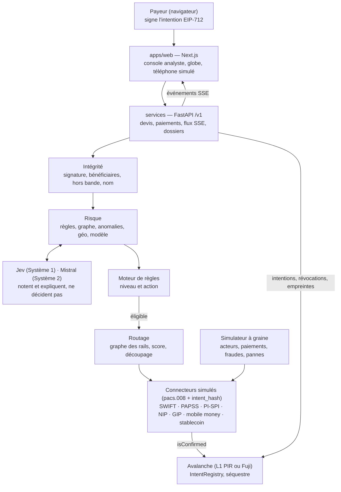

# PRD final — PIR · « L'Aiguilleur »

> v3.0 · 10 octobre 2026 · Secure Horizons (ESSEC) · Track 1 — Fintech Security: Guardians of Value, avec une ouverture possible sur la Track 3.
> **Fusion de quatre PRD** : _L'Aiguilleur_ (Oscar), notre _Payment Integrity Router_ v1.1, _Risk-Aware Payment Router_ et le PRD de Youssef. Comparaison et arbitrages : [`comparaison-prd.md`](./comparaison-prd.md). Sources d'origine : [`prd-sources/`](./prd-sources/) et [`prd.md`](./prd.md) (v1.1, conservé pour l'historique).
> Priorités : **P0** = indispensable à la démo, jamais coupé · **P1** = prêt avant dimanche 6 h · **P2** = bonus / feuille de route.

---

## Vision

> « La route la moins chère quand tout va bien, une fenêtre pour arrêter l'argent quand quelque chose cloche. »

## 1. Résumé

L'Aiguilleur est un routeur de paiements transfrontaliers qui applique les normes des deux pays, évalue le risque, compare les coûts, engage l'intention sur chaîne, puis autorise l'action. La démo principale suit une entreprise lyonnaise qui paie son fournisseur de beurre de karité au Ghana ; Lagos → Accra devient le pack 2. Le routeur **garantit que l'argent ne part que vers le bénéficiaire et le montant engagés**, et retient la fraude avant que l'argent ne bouge.

- **Problème** : les paiements transfrontaliers coûtent cher et les contrôles diffèrent par pays. Les institutions ne voient que leur tronçon ; la fraude (faux fournisseur, mules, prise de contrôle) passe entre les trous.
- **Solution** : (1) profils de juridiction et packs de corridor ; (2) filtres déterministes des normes et du risque ; (3) score de coût S, sans risque de fraude ; (4) intention EIP-712 et attestation vérifiable ; (5) réponse graduée, humaine et rejouable.
- **Périmètre** : France → Ghana en P0 ; pack 2 Lagos → Accra en P1 ; Paris → Abidjan documenté sur papier. Flux et rails simulés, jeu de données étiqueté, `IntentRegistry` étendu et séquestre mode A sur Avalanche.
- **Livrables (dimanche 11 octobre, 12 h)** : dépôt Git avec README, vidéo de démo 2–3 min, deck de 8 slides, fiche de défense, plan de réponse, slide conformité.

## 2. Principes directeurs

1. **Les normes précèdent le risque, qui précède le coût.** Le profil le plus strict des deux extrémités s'applique ; une route interdite est exclue avant tout classement.
2. **Fraude et route sont deux risques distincts.** Le risque de fraude fixe l'action et peut réduire les routes permises ; il n'entre jamais dans S. Changer de route ne rend pas éligible un paiement suspect.
3. **L'intention engagée est la source de vérité.** Chaque jambe doit respecter le bénéficiaire, le montant, la devise, la fenêtre et le nonce signés.
4. **Le commit précède le mouvement.** Les engagements et attestations sont vérifiés avant règlement ; toute révocation ou incohérence bloque l'action.
5. **Les modèles ne peuvent que durcir la décision.** Les règles déterministes filtrent ; Jev et Mistral ne peuvent ni lever une règle ni libérer des fonds. L'humain garde les décisions lourdes.
6. **Échec sûr.** Sans modèle, RPC ou chaîne, le système est plus strict, jamais plus laxiste ; un contrôle impossible retient le paiement.
7. **Confidentiel par défaut, auditable sur demande.** Pseudonymes et régions dans les vues ; aucune donnée personnelle on-chain ; preuve rejouable pour l'auditeur.
8. **Les textes sont des données, jamais des instructions.** Factures, motifs et `RmtInf` ne donnent aucun pouvoir d'action aux modèles ou agents.
9. **Honnêteté de la démo.** Rails et paramètres simulés sont étiquetés ; aucun résultat de sécurité sans mesure ni source.

## 3. Problème terrain

| Friction              | Ce qu'on observe                                                                                                                                                                                                            | Source                                                                                                                                                                                                                                                                                                                                                                                                                                     |
| --------------------- | --------------------------------------------------------------------------------------------------------------------------------------------------------------------------------------------------------------------------- | ------------------------------------------------------------------------------------------------------------------------------------------------------------------------------------------------------------------------------------------------------------------------------------------------------------------------------------------------------------------------------------------------------------------------------------------ |
| Coût                  | Envoyer 200 $ vers l'Afrique subsaharienne coûte 8,46 % en moyenne (T3 2025), contre 6,36 % dans le monde, et 14,99 % via une banque                                                                                        | [Banque mondiale](https://remittanceprices.worldbank.org/sites/default/files/2026-04/RPW_main_report_and_annex_Q325.pdf)                                                                                                                                                                                                                                                                                                                   |
| Détour                | Plus de 80 % des paiements transfrontaliers africains passeraient par des correspondants aux États-Unis ou en Europe (estimation non attribuée), +2 à 5 % par opération                                                     | [TechCabal](https://techcabal.com/2026/03/31/how-papss-is-meeting-cross-border-promise-four-years-on/)                                                                                                                                                                                                                                                                                                                                     |
| Lenteur               | En Afrique, ≈ 25 % des paiements SWIFT arrivent en moins d'une heure ; 35,4 % dans le monde, 75 % visés par le G20 pour 2027                                                                                                | [Swift](https://www.swift.com/insights/news/insights-african-payments-landscape) · [FXC Intelligence](https://www.fxcintel.com/research/reports/ct-retail-payments-g20-cross-border-roadmap-2025)                                                                                                                                                                                                                                          |
| Îlots                 | PI-SPI relie 175 participants dans les 8 pays de l'UEMOA, pas le Nigeria ni le Ghana. PAPSS couvre 28 pays, pas encore la Côte d'Ivoire (pilote UEMOA annoncé sans date)                                                    | [BCEAO](https://www.bceao.int/sites/default/files/2026-10/Communiqu%C3%A9%20du%202%20octobre%202026.pdf) · [Launch Base](https://launchbaseafrica.com/2026/07/09/papss-inches-closer-to-continent-wide-coverage-as-central-african-central-bank-joins/) · [Ecofin](https://www.ecofinagency.com/news-finances/2107-57583-bceao-prepares-papss-pilot-with-more-than-80-west-african-banks)                                                  |
| Plafonds              | Fixés banque par banque : chez FBN Ghana, 2 000 $ par jour pour un particulier sur PAPSS                                                                                                                                    | [FBN Ghana](https://www.fbnbankghana.com/?p=26359)                                                                                                                                                                                                                                                                                                                                                                                         |
| Géographie            | Les francs CFA d'Afrique de l'Ouest et centrale ont la même parité avec l'euro mais ne sont pas interchangeables ; la bonne route dépend de la région du bénéficiaire (compte en ville, portefeuille mobile en zone rurale) | [Banque de France](https://banque-france.fr/system/files/2024-08/zone-franc.pdf)                                                                                                                                                                                                                                                                                                                                                           |
| Fraude                | Nigeria : 25,85 Md₦ de pertes en 2025 (67 518 cas, 63 % à Lagos). Ghana : 16 733 cas en 2024, dont 94 % chez les prestataires de paiement. Côte d'Ivoire : 12 100 affaires, ≈ 6,96 Md FCFA de préjudice en 2024             | [NIBSS](https://nibss-plc.com.ng/nibss-digital-payment-fraud-drops-51-to-%E2%82%A625-85b-in-2025/) · [Banque du Ghana](https://gab.com.gh/assets/images/docs/Overview%20of%20BoG%20Fraud%20Report_UPDATED%20APRIL%202025.pdf) · [KOACI](https://www.koaci.com/article/2025/05/27/cote-divoire/societe/cote-divoire-cybercriminalite-la-plcc-a-enregistre-12100-affaires-en-2024-pour-un-prejudice-de-pres-de-7-milliards-fcfa_187200.html) |
| Faux fournisseur      | Le GIABA classe la messagerie compromise parmi les typologies régionales de blanchiment lié à la cybercriminalité ; ordre de grandeur mondial : 3,05 Md$ de pertes BEC aux États-Unis en 2025 (FBI IC3, voir `projet.md`)   | [Droit Médias Finance](https://droitmediasfinance.com/index.php/actualites/droit-tech-fintech/1006-lutte-anti-blanchiment-cybersecurite-le-giaba-rapporte-sur-7-types-de-blanchiment-de-capitaux-lies-a-la-cybercriminalite-en-afrique-de-louest)                                                                                                                                                                                          |
| Visibilité fragmentée | Chaque institution ne voit qu'un tronçon : un réseau de mules qui traverse plusieurs institutions n'est visible d'aucune isolément                                                                                          | _(analyse, PRD A)_                                                                                                                                                                                                                                                                                                                                                                                                                         |

Question ouverte : aucune donnée publique sur la liquidité des agents de retrait par région ; hypothèse simulée, à dire au jury.

Compléments France → Ghana : les paramètres de route de la démo sont simulés (PRD D, §12.1).

| Point                           | Règle ou donnée                                                                                     | Source                                    |
| ------------------------------- | --------------------------------------------------------------------------------------------------- | ----------------------------------------- |
| Récupération de fraude au Ghana | Environ 5 % en 2025                                                                                 | (PRD D, réf. [10])                        |
| Verification of Payee (VoP)     | Obligatoire dans son périmètre depuis le 9 octobre 2025 ; s'arrête à SEPA                           | (PRD D, réf. [32])                        |
| Recettes d'exportation          | Le crédit doit parvenir à la banque désignée ; acceptation d'un détour via VASP à confirmer pour R3 | (PRD D, réf. [33] ; à revérifier pour R3) |
| EURC                            | Cadre MiCA côté UE ; au Ghana, VASP Act 2025. La démo ne vaut pas avis juridique                    | (PRD D, réf. [16, 22, 23])                |
| Côte d'Ivoire                   | Figure sur la liste UE des pays tiers à haut risque                                                 | (PRD D, réf. [34])                        |

## 4. Utilisateurs et personas

Le client payant est la fintech qui émet les paiements ; l'utilisateur quotidien de la console est son analyste fraude et conformité ; le payeur reste maître de son intention.

| Persona                                                 | Qui                                                             | Ce qu'il veut                                                             | Ce que le produit lui apporte                                                                 |
| ------------------------------------------------------- | --------------------------------------------------------------- | ------------------------------------------------------------------------- | --------------------------------------------------------------------------------------------- |
| Fintech émettrice                                       | Plateforme de paiement B2B, société de transfert, néobanque     | Moins de frais, plus de paiements aboutis, une seule intégration          | API qui note les routes, choisit la meilleure, contrôles inclus                               |
| **Analyste fraude et conformité**                       | Équipe risque de la fintech                                     | Moins d'alertes inutiles, dossiers complets, déclarations dans les délais | File d'alertes expliquées, chronologie et tracé sur le globe, déclaration pré-remplie         |
| **Claire, entreprise lyonnaise** (payeur)               | Crée et signe l'intention de paiement à Savanna Shea Exports    | Prix connu d'avance, délai fiable, ne pas se faire piéger                 | Devis comparé aux routes conformes ; vérification hors bande avant mouvement                  |
| **Kwame, contact connu du fournisseur**                 | Confirme ou refuse hors bande                                   | Garder le contrôle du compte fournisseur                                  | Vérification sur un contact enregistré, après contrôle SIM-swap                               |
| **Adaeze, DAF d'une PME importatrice à Lagos** (pack 2) | Crée et signe l'intention, confirme ou annule les retenues      | Prix connu d'avance, délai fiable, ne pas se faire piéger                 | PAPSS, mobile money et itinéraire vers sa famille à Tamale                                    |
| Second approbateur                                      | Co-signe au-delà du seuil                                       | Garder le contrôle sans tout relire                                       | Double contrôle seulement au-delà du seuil                                                    |
| **Savanna Shea Exports** (bénéficiaire)                 | Fournisseur ghanéen de beurre de karité ; contact connu : Kwame | Être payé vite, nom vérifié                                               | Paiement traçable ; aucun crédit avant vérification                                           |
| Famille à Tamale (bénéficiaire rural, nord du Ghana)    | Retire l'argent                                                 | Retirer près de chez elle                                                 | Livraison sur le portefeuille de l'opérateur présent dans sa région                           |
| Auditeur / régulateur                                   | Vérifie a posteriori                                            | Rejouer une décision, prouver qu'elle n'a pas été réécrite                | Journal hash-chaîné, empreintes et intentions sur Avalanche, versions des règles et du modèle |
| Ops                                                     | Supervise rails et connecteurs                                  | Couper un rail ou un connecteur compromis                                 | État des rails, kill switch, mode dégradé                                                     |

## 5. Objectifs, non-objectifs et indicateurs

**Objectifs** : (1) comparer les routes conformes France → Ghana et, en extension, dans les packs ; (2) **zéro détournement** : aucun paiement exécuté vers un bénéficiaire ou un montant différent de l'intention engagée ; (3) détecter les fraudes injectées avant exécution, avec un gain mesuré dû à la vue complète, à la géographie et aux signaux de normes ; (4) répondre de façon graduée, tracée et vérifiable par un tiers.

**Non-objectifs** : aucune connexion à un vrai rail ni donnée réelle (règlement du hackathon) ; aucune détention de fonds ni vérification d'identité réelle ; aucune application grand public ; aucune exécution du pack Paris → Abidjan.

| Indicateur                                   | Objectif interne                                                  | Référence                             | Critère du jury      |
| -------------------------------------------- | ----------------------------------------------------------------- | ------------------------------------- | -------------------- |
| Taux de détournement                         | **0** sur le jeu d'attaque (substitution, rejeu, montant modifié) | —                                     | Détection (30 %)     |
| Rappel par typologie de fraude               | ≥ 85 %                                                            | Objectif d'équipe                     | Détection            |
| Faux positifs sur paiements honnêtes         | ≤ 2 %                                                             | Objectif d'équipe                     | Détection            |
| Gain dû à la vue complète et à la géographie | Écart de rappel à faux positifs égaux                             | Institution isolée ; sans signaux géo | Détection            |
| Délai de détection d'une campagne            | Temps entre le premier acte et la première alerte                 | Institution isolée                    | Détection            |
| Fraudes stoppées avant exécution             | 100 % des fraudes détectées                                       | —                                     | Réponse (20 %)       |
| Coût tout compris (frais + écart de change)  | ≤ 1 % au-delà de 200 $                                            | Cible G20 ; 8,46 % aujourd'hui        | Faisabilité (20 %)   |
| Part créditée en moins d'une heure           | ≥ 75 %                                                            | Cible G20 ; 35,4 % dans le monde      | Faisabilité          |
| Part utilisable sur place                    | ≥ 95 %                                                            | Indicateur propre                     | Réponse              |
| Latence de décision                          | p95 < 300 ms hors Jev et chaîne ; < 1 s aux 2 points Jev          | —                                     | Faisabilité          |
| Paiements légitimes sans intervention (STP)  | > 90 %                                                            | —                                     | Réponse              |
| Décisions rejouables par un auditeur         | 100 %                                                             | Journal + Avalanche                   | Conformité (15 %)    |
| Délai d'affichage                            | < 1 s entre un événement et son tracé                             | —                                     | Pitch et démo (15 %) |

Les KPI coût et délai sont **illustratifs** (rails simulés) ; seuls les KPI de sécurité sont réellement mesurés sur le jeu.

## 6. Scénario de démo (3 min + scènes bonus)

Démo centrale : paiement simulé de **EUR 85 000 en EURC** par Claire, à Lyon, à son fournisseur de beurre de karité **Savanna Shea Exports**, contact connu Kwame. Montant, routes et paramètres de prix sont simulés (PRD D, §12.1). Si eERC P1 n'est pas prêt, le montant public en EURC est annoncé avant le transfert. Pas de promesse de paiement réel.

| Étape    | Scène                                                                                                                                                                                                                                                                                                                                                                       | Ce que voit le jury                                                                                                                                       |
| -------- | --------------------------------------------------------------------------------------------------------------------------------------------------------------------------------------------------------------------------------------------------------------------------------------------------------------------------------------------------------------------------- | --------------------------------------------------------------------------------------------------------------------------------------------------------- |
| 0:00     | **Globe** : France → Ghana, pack chargé, événements de démonstration                                                                                                                                                                                                                                                                                                        | Fil texte et globe reflètent les mêmes événements ; chaque route porte son étiquette de simulation.                                                       |
| Scène 1  | Paiement légitime simulé de Claire. Les normes écartent R4 et affichent pourquoi ; le moteur choisit la route conforme la moins coûteuse ; `PaymentCommitted` apparaît sur l'explorer.                                                                                                                                                                                      | Route, décomposition du score, intention signée ; transfert eERC si P1 est prêt, sinon EURC public annoncé.                                               |
| Scène 2  | **Fil rouge simulé.** Nouvelle facture par e-mail, nouveau compte : signaux B1–B4, R1, G3, N2/N3 et règles conduisent à « moyen ». Seules les routes à règlement conditionnel restent ; intention engagée puis `Deposited`. Après le contrôle SIM-swap du contact connu, Kwame refuse la demande hors bande ; `VerificationRecorded(DENIED)`, `PaymentRevoked`, `Refunded`. | Jev pose ses deux questions de signature. Mistral prépare un dossier d'enquête en ≤ 60 s et une explication ≤ 120 mots ; il ne déclenche jamais d'action. |
| Scène 2b | Attaque simulée par substitution ou rejeu : le connecteur simulé refuse sur `intent_hash` ; la transaction on-chain revert avec `PaymentNotReleasable`. Kill switch du connecteur.                                                                                                                                                                                          | Liens explorer avant et après révocation ; l'attaque échoue côté connecteur et côté contrat.                                                              |
| Scène 3  | Grappe de mules et vague de fraude simulées ; coupe-circuit et déclaration préremplie.                                                                                                                                                                                                                                                                                      | Vue réseau, seuils abaissés et validation humaine.                                                                                                        |
| Bilan    | Résultats mesurés sur la graine B du jeu simulé.                                                                                                                                                                                                                                                                                                                            | Rappel, faux positifs, gain des signaux de normes et zéro détournement sur les attaques testées.                                                          |

**Scènes bonus P1 simulées** : charger le pack Lagos → Accra depuis un seul fichier ; montrer PAPSS, Adaeze et sa famille à Tamale, une panne et le reroutage.

| Attente du mentor                        | Preuve dans la démo                                        | Preuve on-chain                                              |
| ---------------------------------------- | ---------------------------------------------------------- | ------------------------------------------------------------ |
| Normes par juridiction et choix de route | Scène 1, profil FR-GH ; R4 exclue avec raison              | `PaymentCommitted`                                           |
| Faux fournisseur retenu avant règlement  | Scène 2, vérification du contact connu et refus hors bande | `VerificationRecorded(DENIED)`, `PaymentRevoked`, `Refunded` |
| Résistance à la substitution et au rejeu | Scène 2b, tentative refusée, kill switch                   | Revert `PaymentNotReleasable`                                |
| Détection d'une campagne et réponse      | Scène 3, grappe, coupe-circuit, analyste                   | Empreinte de décision ancrée au journal                      |

## 7. Exigences fonctionnelles

Exactement 14 modules P0 ; chaque module a un critère d'acceptation testable. Charge ≈ 57 h·p pour ≈ 56 h·p disponibles : à la limite, l'ordre de coupe s'applique dès le checkpoint.

| ID  | Module                                                                | Critère d'acceptation                                                                                                                                                                                            | h·p / priorité |
| --- | --------------------------------------------------------------------- | ---------------------------------------------------------------------------------------------------------------------------------------------------------------------------------------------------------------- | -------------: |
| F1  | Profils, packs et moteur de normes                                    | Un test FR-GH exclut R4 et explique la règle déclenchée.                                                                                                                                                         |              5 |
| F2  | Intention / `PaymentCommitment` EIP-712 (`packages/core` existant)    | TS, Python et Solidity valident le même vecteur ; toute modification crée un nouvel engagement.                                                                                                                  |              2 |
| F3  | Bénéficiaires vérifiés, nom, SIM swap (mock CAMARA), hors bande       | Nouveau compte issu d'un document non fiable : au moins « moyen », signature vers route conditionnelle seulement ; fonds libérés uniquement après contrôle SIM-swap et vérification hors bande du contact connu. |              5 |
| F4  | Routage : normes → risque → coût                                      | Les filtres précèdent S ; le test montre que la fraude n'entre pas dans S.                                                                                                                                       |              4 |
| F5  | Connecteurs simulés vérifiant `intent_hash`                           | Les tests de substitution et de rejeu sont refusés avant `initiate`.                                                                                                                                             |              3 |
| F6  | Moteur de risque (règles, graphe, géo, signaux de normes, modèle GBM) | Le jeu restitue les signaux, le niveau et la décision ; modèle évalué sur graine non vue.                                                                                                                        |              7 |
| F7  | Jev, deux questions                                                   | Deux questions de signature donnent une réponse en cache ou en direct, sans action.                                                                                                                              |              2 |
| F8  | Réponse graduée, coupe-circuit, kill switch                           | Les quatre niveaux et l'abaissement temporaire des seuils sont rejouables.                                                                                                                                       |              3 |
| F9  | Console analyste + Mistral (dossier, explication)                     | Dossier prêt en ≤ 60 s, explication ≤ 120 mots ; Mistral ne déclenche aucune action.                                                                                                                             |              6 |
| F10 | Globe + fil texte                                                     | Scènes 1, 2 et 2b affichent les événements ; le fil reste lisible sans globe.                                                                                                                                    |              5 |
| F11 | Données étiquetées et simulateur à graine                             | Même graine = mêmes transactions, attaques, pannes et métriques.                                                                                                                                                 |              4 |
| F12 | `IntentRegistry` étendu + séquestre mode A + scène 2b                 | `release` exige `CONFIRMED` ; révocation et rejeu revert ; remboursement à l'expiration.                                                                                                                         |              6 |
| F13 | Évaluation et ablations (dont signaux de normes)                      | Script graine A/B compare références et ablations ; résultats du pitch reproductibles.                                                                                                                           |              3 |
| F14 | Fondations et fixtures                                                | Rôles, données et contrats de test initiaux se chargent avec un `seed` idempotent.                                                                                                                               |              2 |
| F20 | Pack 2 Lagos → Accra                                                  | Le profil Nigeria et le pack NG-GH se chargent depuis un fichier, sans modifier le moteur.                                                                                                                       |             P1 |
| F21 | Mode dégradé                                                          | Jev, Mistral ou chaîne indisponibles → règles + modèles + humain, bandeau ; aucun déblocage par défaut                                                                                                           |             P1 |
| —   | Bonus                                                                 | Jambe stablecoin eERC avec clé auditeur (partiel sur branche), attestation de bénéficiaire EIP-712, VC KYB, Travel Rule IVMS101, honeytokens, prédicteurs en ligne, mode ombre pour PSP, information fiscale     |             P2 |

**P1** : pack 2 Lagos → Accra chargé depuis un fichier ; eERC pour paiements faibles (time-box de 3 h) ; information fiscale, jamais un critère d'éligibilité ; L1 PIR si prête ; déclaration de soupçon ; quorum RPC à deux fournisseurs ; extraction de facture ; mode dégradé ; signaux R2–R4 ; ancrage Merkle ; découpage technique.

**P2** : eERC mode B ; guardian ; L1 consortium permissionnée ; watch agent ; pack 3 Paris → Abidjan sur papier ; extensions v2.0 indiquées ci-dessus.

Dans la ligne Bonus héritée de v2.0, l'eERC avec clé auditeur désigne le mode B P2 ; le transfert confidentiel simple des paiements faibles reste P1.

## Ordre de décision

1. **NORMES** — filtre dur sur les deux juridictions ; la règle la plus stricte s'applique.
2. **RISQUE** — filtre dur sur l'ensemble des routes restantes, selon le niveau.
3. **COÛT** — classement par le score S inchangé de la section suivante ; le risque de fraude n'entre jamais dans S.
4. **COMMIT** — signature EIP-712 et vérification on-chain avant mouvement.
5. **ACTION** — exécution, maintien conditionnel, refus ou blocage selon règles et attestations.

## 8. Spécification du routage

Le routage n'est appelé qu'après les filtres de normes et de risque. Il reçoit les routes conformes encore autorisées par le niveau ; moyen = règlement conditionnel seulement. Chaque route reçoit S ; le plus bas gagne et seule cette route est renvoyée.

**Graphe** : nœuds = couple institution × région (monnaie, coordonnées GeoNames / Natural Earth) ; arêtes = rails (frais fixes et en %, écart de change, délai p50 et p95, plafonds par opération et par jour, horaires UTC, justificatifs, état ouvert / congestionné / en panne).

```math
S(r, p) = C(r) + \lambda \, T(r) + \mu \, K \, P_{\mathrm{echec}}(r) + \nu \, K \, P_{\mathrm{inutil}}(r) + \sigma \, R_{\mathrm{route}}(r)
```

- C : coût tout compris en % du montant ; T : délai attendu en heures (heures limites et fuseaux compris) ; P échec : plafond, liquidité, justificatif ; K : coût d'un échec ; P inutil : argent non utilisable dans la région du bénéficiaire ; λ, μ, ν, σ réglables par client.
- **R route** : risque _opérationnel ou de sécurité du rail_ (taux d'échec anormal, intermédiaire peu fiable, connecteur sous kill switch). **Le risque de fraude de la transaction n'entre pas dans S** (principe 2) : il fixe l'action (§10) et peut seulement restreindre l'ensemble des routes (niveau moyen → routes avec séquestre ou rappel possible).

**Algorithme** : (1) filtrer rails fermés, en panne, hors plafond, interdits dans le pays (stablecoin en UEMOA) ou sous kill switch ; (2) 5 meilleurs chemins par l'algorithme de Yen (`networkx.shortest_simple_paths`) ; (3) noter avec S, renvoyer le meilleur et sa raison, journaliser les autres ; (4) si plafond ou liquidité l'imposent, découper (P1) avec le CVXPY existant (repli OR-Tools `SimpleMinCostFlow`, poids entiers) ; (5) devis valable 600 s, comme Nexus ; (6) jambe fermée → planifiée à l'ouverture.

**Règles géographiques** : profils et packs déclarent fuseaux, plafonds, rails autorisés et couverture. Rester dans la zone monétaire quand c'est possible ; livrer sur le rail présent dans la région du bénéficiaire, pondéré par un indice de liquidité des agents (hypothèse simulée) ; rerouter à la panne et revenir quand le rail est disponible.

**France → Ghana — paramètres de preuve de concept simulés** (PRD D, §12.1) :

| Route | Chemin                                                                                            | Coût / délai simulés                                                                        | Règlement                                                    |
| ----- | ------------------------------------------------------------------------------------------------- | ------------------------------------------------------------------------------------------- | ------------------------------------------------------------ |
| R1    | Banque française → correspondant SWIFT → banque ghanéenne désignée                                | €80 ; 1–3 jours ouvrés                                                                      | Rappel non garanti ; retenue fiat possible côté émetteur     |
| R2    | Banque française → prestataire agréé (SEPA Instant) → versement local en GHS à la banque désignée | 0,1 % + change 1,0 % ≈ €935 ; < 1 h                                                         | Pas de rappel après versement, pas de règlement conditionnel |
| R3    | Banque française → CASP UE (EUR → EURC) → Avalanche → VASP ghanéen agréé → banque désignée        | CASP 0,10 % + VASP 0,10 % + gas ≈ €0, total €170 ; minutes on-chain + crédit bancaire < 2 h | Révocable pendant le séquestre ; eERC P1                     |
| R4    | Prestataire de transfert → portefeuille mobile                                                    | 1,5 % ; minutes                                                                             | Ni rappel ni règlement conditionnel                          |

Le profil Ghana exige que les recettes d'exportation atteignent la banque désignée : R4 est exclue pour les biens. L'éligibilité de R3 pour ces recettes reste **à revérifier** ; le pack peut l'interdire tant que le passage par VASP n'est pas confirmé. Plafond de portefeuille (KYC renforcé) : GHS 25 000 par jour (PRD D, réf. [11]). La VoP ne remplace pas une vérification hors bande hors SEPA.

Sources : [Nexus](https://docs.nexusglobalpayments.org/fx-provision/quotes.md) · [networkx](https://networkx.org/documentation/stable/reference/algorithms/generated/networkx.algorithms.simple_paths.shortest_simple_paths.html) · [OR-Tools](https://developers.google.com/optimization/flow/mincostflow) · [Trésor](https://www.tresor.economie.gouv.fr/tresor-international/la-zone-franc/les-principes-et-modalites-de-fonctionnement-de-la-cooperation-monetaire) · [PAPSS](https://papss.com/how-it-works/)

## Moteur de normes et packs

Chaque pays porte un profil déclaratif ; chaque corridor est un fichier pack. Les règles s'évaluent aux deux extrémités et la plus stricte s'applique avant le score de risque. Une norme interdite exclut la route ; un modèle ne peut pas la réactiver.

| Périmètre                            | Priorité       | Décision de démonstration                                                                                                                    |
| ------------------------------------ | -------------- | -------------------------------------------------------------------------------------------------------------------------------------------- |
| Profils France + Ghana et pack FR-GH | P0             | France → Ghana, scénario principal ; profil Ghana exige le crédit des recettes d'exportation à la banque désignée.                           |
| Signal de norme R1                   | P0             | Scène 2 : recettes d'exportation routées hors banque désignée deviennent aussi un signal de fraude.                                          |
| Profil Nigeria + pack NG-GH          | P1             | Pack 2 Lagos → Accra, chargé depuis un fichier ; conserve PAPSS, mules, mobile money, Adaeze et sa famille à Tamale.                         |
| Signaux R2–R4                        | P1             | Extension de détection paramétrée par pack ; règles exactes versionnées et sourcées dans le profil.                                          |
| France–Ghana, information fiscale    | P1             | Avis informatif au payeur et à son équipe fiscale ; jamais un critère d'éligibilité, pas de calcul ni de conseil fiscal.                     |
| Côte d'Ivoire                        | Papier         | Pack 3 Paris → Abidjan documenté seulement ; pas de crypto en UEMOA, retenue fiat ; CI est sur la liste UE à haut risque (PRD D, réf. [34]). |
| Chine                                | Hors périmètre | Corridor rejeté pour cette démo : interdictions crypto et contrôles des capitaux incompatibles avec le scénario stablecoin.                  |

Les informations fiscales France–Ghana s'appuient sur la convention de non-double imposition (PRD D, réf. [35]). Les profils restent versionnés et auditables ; le chargement d'un pack ne modifie pas le code du moteur.

## 9. Spécification du risque de fraude

La décision suit trois étages, dans cet ordre :

1. **Intégrité (déterministe, < 5 ms)** : intention signée, bénéficiaire vérifié ou non, provenance des champs, nom du titulaire, sanctions (liste synthétique), plafonds, time-lock, double contrôle. Une interdiction ici est définitive.
2. **Score de fraude 0–100 (< 300 ms)** : règles, indicateurs de graphe (entrées / sorties multiples, cycles courts `networkx.simple_cycles`, temps de passage), anomalies (IsolationForest ou PyOD), modèle supervisé (gradient boosting, entraîné sur la graine A, testé sur la graine B), signaux géographiques.
3. **Jev (sémantique, à la signature)** : il lit la facture et le contexte ; le modèle juge le comportement, Jev la sémantique — leur désaccord est informatif.

| Typologie                        | Signaux principaux                                                                                      | Source                                                                                                                                                                                                                             |
| -------------------------------- | ------------------------------------------------------------------------------------------------------- | ---------------------------------------------------------------------------------------------------------------------------------------------------------------------------------------------------------------------------------- |
| **Faux fournisseur** (fil rouge) | Compte créé ou modifié récemment, provenance « PDF par e-mail », nom ≠ facture, domaine proche, urgence | [GIABA](https://droitmediasfinance.com/index.php/actualites/droit-tech-fintech/1006-lutte-anti-blanchiment-cybersecurite-le-giaba-rapporte-sur-7-types-de-blanchiment-de-capitaux-lies-a-la-cybercriminalite-en-afrique-de-louest) |
| **Substitution en transit**      | Jambe ≠ intention, nonce déjà consommé, intention révoquée                                              | Empêchée par F5, pas seulement détectée                                                                                                                                                                                            |
| Réseau de comptes mules          | Afflux multi-pays vers un portefeuille, vidage en minutes, retraits chez peu d'agents                   | [GAFI](https://www.fatf-gafi.org/content/dam/fatf-gafi/reports/Illicit-financial-flows-cyber-enabled-fraud.pdf.coredownload.inline.pdf)                                                                                            |
| Fractionnement sous les seuils   | Montants répétés juste sous un plafond, sur plusieurs comptes                                           | [FIC Ghana](https://fic.gov.gh/images/2026/Advisory_Notice_-_1.pdf)                                                                                                                                                                |
| Prise de contrôle et SIM swap    | SIM changée récemment, appareil ou pays inhabituel, déplacement impossible                              | [GSMA](https://www.gsma.com/mobilefordevelopment/wp-content/uploads/2024/03/GSMA-Fraud-Typologies-04-03-24.pdf)                                                                                                                    |
| Victime d'arnaque                | Premier envoi vers ce corridor, montant inhabituel, bénéficiaire signalé                                | [Interpol](https://www.interpol.int/News-and-Events/News/2025/African-authorities-dismantle-massive-cybercrime-and-fraud-networks-recover-millions)                                                                                |
| Collusion d'agent (P1)           | Dépôts découpés près des paliers de commission                                                          | [arXiv 1910.05596](https://arxiv.org/pdf/1910.05596)                                                                                                                                                                               |

**Signaux géographiques** : distance appareil / compte (région) ; déplacement impossible (> 900 km/h) ; portefeuille ouvert dans une région et vidé dans une autre ; retraits d'une grappe concentrés près d'une frontière ; vague de fraude en cours dans le corridor.

**Signaux de normes** : R1 (P0) détecte les recettes d'exportation routées hors de la banque désignée ; R2–R4 (P1) sont configurés par pack et ne remplacent pas le filtre légal. L'évaluation mesure séparément leur apport.

**Seuils** (réglables) : 0–39 faible, 40–69 moyen, 70–89 élevé, 90–100 critique. Désaccord modèle / Jev > 0,4 → au moins élevé. Budget d'alertes : 3 % des légitimes sur 30 jours ; un ajustement ne touche que la zone grise, jamais une règle.

| Niveau            | Routes autorisées                                                               | Décision                                                                                               |
| ----------------- | ------------------------------------------------------------------------------- | ------------------------------------------------------------------------------------------------------ |
| Faible (0–39)     | Toutes les routes conformes                                                     | Route la moins coûteuse selon S.                                                                       |
| Moyen (40–69)     | Routes à règlement conditionnel seulement : séquestre Fuji / L1 ou retenue fiat | `release` uniquement après attestation `CONFIRMED` ; remboursement automatique à l'expiration de 24 h. |
| Élevé (70–89)     | Aucune                                                                          | Signature bloquée ; payeur et analyste avisés.                                                         |
| Critique (90–100) | Aucune                                                                          | Blocage et déclaration de soupçon.                                                                     |

Un compte nouveau issu d'un document non fiable est au moins « moyen » : le payeur peut signer uniquement une intention vers une route à règlement conditionnel ; les fonds ne quittent pas le séquestre avant vérification hors bande du contact connu, après contrôle SIM-swap.

## 10. Plan de réponse (livrable « playbook »)

| Niveau                       | Action automatique                                                                                                         | Action humaine                           | Délai                                     |
| ---------------------------- | -------------------------------------------------------------------------------------------------------------------------- | ---------------------------------------- | ----------------------------------------- |
| Faible (0–39)                | Meilleure route conforme                                                                                                   | Aucune                                   | Immédiat                                  |
| Moyen (40–69)                | Séquestre L1 / Fuji ou retenue fiat ; `release` seulement après attestation `CONFIRMED` ; remboursement automatique à 24 h | Analyste suit les exceptions             | Maximum 24 h avant remboursement          |
| Élevé (70–89)                | Aucune route ; signature bloquée                                                                                           | Payeur et analyste avisés                | Jusqu'à décision humaine                  |
| Critique (90–100)            | Blocage et dossier de déclaration de soupçon prérempli                                                                     | Analyste valide et transmet à la cellule | Selon les délais du profil de juridiction |
| Connecteur ou rail compromis | **Kill switch** du connecteur, **révocation** inscrite on-chain, reroutage des paiements sains                             | Ops réactive                             | Immédiat                                  |

**Coupe-circuit régional** : quand une grappe touche une région ou un corridor, le niveau du périmètre visé est au minimum « moyen » et ses seuils baissent de 20 points pendant 24 h ; seul un humain le lève plus tôt.

**Qui est prévenu** : l'analyste (console) ; le payeur (hors bande, niveaux moyen et élevé) ; l'institution destinataire (alerte portant l'UETR) ; la cellule de renseignement financier, uniquement par l'analyste ; **jamais le client visé par une déclaration** (interdit par la loi ivoirienne).

**Trace** : chaque action est horodatée, rattachée aux versions des règles et du modèle, chaînée dans le journal, et son empreinte est écrite sur Avalanche.

## 11. Expérience : le paiement tracé en direct

Le globe ne calcule rien : il dessine les événements publiés par l'API, chacun avec l'UETR, l'heure et les coordonnées des institutions.

| Événement                                                             | Ce que fait le globe                                           |
| --------------------------------------------------------------------- | -------------------------------------------------------------- |
| `intent.signed`, `intent.published`                                   | Badge « signé », lien explorer                                 |
| `PaymentCommitted`, `Deposited`                                       | Engagement puis dépôt sur l'explorer                           |
| `route.selected`                                                      | Dessine la seule route retenue, saut par saut                  |
| `risk.scored`                                                         | Affiche le score, colore le tracé (vert, ambre, orange, rouge) |
| `hop.sent`, `hop.settled`                                             | Comète sur le saut, onde à l'institution atteinte              |
| `leg.rejected`                                                        | Croix rouge sur le connecteur (substitution refusée)           |
| `escrow.locked`, `escrow.released`                                    | Cadenas avant le dernier saut, puis ouverture                  |
| `VerificationRecorded(DENIED)`, `PaymentRevoked`, `Refunded`          | Refus attesté, révocation et remboursement visibles            |
| `PaymentNotReleasable`                                                | Revert on-chain dans la scène 2b                               |
| `payment.held`, `payment.blocked`                                     | Fige le tracé en orange ou rouge, ouvre le dossier             |
| `payment.credited`                                                    | Onde verte chez le bénéficiaire, bilan coût, délai, économie   |
| `alert.raised`                                                        | Anneaux, grappe ou déplacement impossible sur la région        |
| `rail.down`, `rail.up`, `breaker.on`, `breaker.off`, `intent.revoked` | Rail en pointillés rouges, région teintée, révocation          |

**P0** : réseau (`pointsData`, `labelsData`, `arcsData`), route retenue et comète, couleur de risque, anneaux d'alerte, rail en panne, fil texte. **P1** : trafic de fond, hexagones de grappe, polygones de coupe-circuit, arc stablecoin surélevé, horloge accélérée.

**Règles** : une seule route visible par paiement ; régions et institutions seulement, jamais la position d'une personne ; au-delà de 10 s, temps accéléré avec horloge du délai réel simulé.

**Technique** : react-globe.gl 2.38 chargé dans un composant client (`next/dynamic`, `ssr: false`) ; un seul flux SSE pour toute la console (limite de 6 connexions par domaine en HTTP/1.1), `id` par événement pour la reprise ; textures et frontières servies en local ; plan B : vidéo enregistrée samedi soir et fil texte sans WebGL.

## 12. Architecture technique



| Composant                                    | Technologie                                                                                                 | Existant dans le dépôt                                                    |
| -------------------------------------------- | ----------------------------------------------------------------------------------------------------------- | ------------------------------------------------------------------------- |
| Console, globe, signature                    | Next.js, TypeScript, Tailwind, react-globe.gl, viem                                                         | `apps/web` (DA, i18n, composants)                                         |
| Types, `intentHash`, EIP-712                 | `packages/core`                                                                                             | branche `core-package` (test croisé Foundry)                              |
| API, routage, risque, simulateur, évaluation | Python 3.12, FastAPI (SSE natif), networkx, CVXPY, scikit-learn, PyOD, `eth_account` (vérification EIP-712) | `services/sor` (SOR CVXPY, FastAPI)                                       |
| Stockage                                     | Supabase / Postgres local                                                                                   | `supabase/`                                                               |
| Contrats                                     | Solidity, Foundry, OpenZeppelin 5.x                                                                         | `IntentRegistry` (branche), `TradeEscrow` (main), eERC (branche, partiel) |
| Chaîne                                       | L1 PIR (Subnet-EVM, chainId 7810, script `infra/avalanche/l1-local.sh`) ou Fuji (43113)                     | branche `avalanche-l1-locale`                                             |
| IA                                           | Jev `openjev-latest` via Codiv ; Mistral                                                                    | clés dans `apps/web/.env.local`                                           |

**Point de vigilance** : `intent_hash` doit être identique en TypeScript, Python et Solidity → EIP-712 (standard) et **un vecteur de test commun** dans les trois suites dès samedi soir.

## Conception on-chain

Le contrat existant de la branche `intent-registry` garde son nom **`IntentRegistry`** et ses fonctions `publish`, `revoke` et `isConfirmed`. Il est étendu aux trois types EIP-712 — `PaymentCommitment` (équivalent fonctionnel de notre `PaymentIntent`), `VerificationAttestation` et `Revocation` — avec vérification des signatures on-chain.

**Mode A, P0** : séquestre EURC public. Le montant reste visible. `release` n'exige pas de rôle particulier, mais le contrat ne libère les fonds que si le registre renvoie `CONFIRMED` ; à l'expiration de 24 h, remboursement automatique. Le connecteur vérifie également `intent_hash`, fenêtre, nonce et révocation avant le règlement.

**Question ouverte pour le propriétaire chaîne** : réutiliser ou remplacer le contrat de séquestre existant à trois tranches (`TradeEscrow`). Ne pas trancher dans cette version.

**Confidentialité** : transferts eERC confidentiels pour les paiements faibles en P1, avec time-box de 3 h ; une partie du code existe sur `eerc-converter`. Les montants sont chiffrés ; le destinataire et l'auditeur désigné peuvent les lire. Un contrat ne peut pas créer seul la preuve de transfert eERC. Si l'essai échoue dans ce délai, la scène emploie le mode A public.

**Mode B, P2 — règlement confidentiel conditionnel** : eEURC détenu par un dépositaire enregistré ; son signataire ne produit la preuve de transfert que si le registre indique `CONFIRMED` pour le bon `paymentId` et que le montant correspond à l'engagement. Un guardian surveille chaque sortie et l'auditeur peut déchiffrer le montant. Modèle de confiance honnête : le mode A empêche un déblocage non autorisé par le contrat ; le mode B détecte une sortie non autorisée dans le bloc, car le dépositaire pourrait théoriquement signer malgré tout.

**Réseau et preuve** : cible = L1 PIR dédiée si opérationnelle dimanche 0 h, sinon Fuji C-Chain. Explorer du mentor sur la L1 ; Snowtrace sur Fuji. Vérification Chainlist + chain-ID P0 ; quorum de deux fournisseurs RPC P1 ; ancrage Merkle du journal P1 ; consortium L1 permissionnée avec allowlists P2.

**À décider** : détenteur de la clé auditeur eERC et détenteurs des clés d'attestation. Aucun montant ou donnée personnelle n'est écrit en clair sur chaîne en mode eERC ; les engagements ne contiennent que les empreintes prévues.

## 13. Modèle de données et API

| Entité                               | Champs clés                                                                                                                                                                   |
| ------------------------------------ | ----------------------------------------------------------------------------------------------------------------------------------------------------------------------------- |
| Institution                          | id, nom, type (banque, monnaie électronique, mobile money, rampe stablecoin), pays, régions, BIC ou code local                                                                |
| Rail                                 | id, type, monnaies, frais, écart de change, délai p50 / p95, plafonds, horaires UTC, justificatifs, état, pays autorisés                                                      |
| Région                               | id, pays, coordonnées, opérateur dominant, indice de liquidité des agents (simulé)                                                                                            |
| PaymentCommitment                    | payeur, bénéficiaire (réf. registre), compte, montant, devise, échéance, `invoice_hash`, provenance par champ, contraintes, signature(s), `intent_hash`, nonce, `valid_until` |
| VerificationAttestation / Revocation | référence au `PaymentCommitment`, résultat, motif, signataire, nonce, signature EIP-712, horodatage                                                                           |
| Bénéficiaire / compte                | identifiants, `first_seen`, paiements réussis, preuves, statut de vérification hors bande                                                                                     |
| Paiement                             | uetr (UUID v4), `intent_hash`, régions, route choisie, score, niveau, statut                                                                                                  |
| Étape (PaymentLeg)                   | uetr, `intent_hash`, nonce, rail, rang, institutions, horodatages, statut                                                                                                     |
| Dossier                              | id, paiements liés, typologie, score, signaux, réponses Jev, explication, actions, décision humaine                                                                           |
| Décision / LedgerEvent               | id, uetr, versions des règles et du modèle, empreinte des preuves, hash précédent, transaction on-chain                                                                       |

**Format pivot** (sous-ensemble pacs.008.001.08) : `UETR` obligatoire et inchangé, `Dbtr`, `DbtrAgt`, `Cdtr`, `CdtrAgt`, `IntrmyAgt1`, `InstdAmt`, `XchgRate`, `ChrgBr`, `Purp`, `RmtInf/Ustrd` (≤ 140 caractères), adresses structurées ; **`intent_hash` et nonce en `SplmtryData`**.

| Méthode et route                               | Rôle                                                                                 |
| ---------------------------------------------- | ------------------------------------------------------------------------------------ |
| `POST /v1/intents`                             | Enregistre une intention signée ; renvoie `intent_hash` et les vérifications exigées |
| `POST /v1/payees/{id}/verify`                  | Lance ou valide la vérification hors bande                                           |
| `POST /v1/name-check`                          | Compare nom attendu et nom du titulaire (comme la GSMA Mobile Money API)             |
| `POST /v1/quotes`                              | Meilleure route et sa raison, valable 600 s                                          |
| `POST /v1/payments`                            | Exécute un devis ; renvoie UETR, score, niveau, action                               |
| `GET /v1/payments/{uetr}`                      | Statut étape par étape (modèle pacs.002)                                             |
| `GET /v1/stream`                               | Flux SSE de tous les événements (§11)                                                |
| `GET /v1/directory/{alias}`                    | Alias → rail, institution, région, nom masqué                                        |
| `GET /v1/cases`, `POST /v1/cases/{id}/actions` | File d'alertes ; libérer, retenir, bloquer, déclarer                                 |
| `POST /v1/sim/events`                          | Injecte panne, fraude ou connecteur compromis                                        |
| `GET /v1/metrics`                              | Indicateurs, avec et sans vue complète et géographie                                 |

## 14. Données synthétiques

Le tableau des sept rails de B devient le pack 2 Lagos → Accra ; les rails CI restent documentés pour l'extension papier. Les flux sont simulés et les paramètres de rails sont des ordres de grandeur tirés des sources de B.

| Rail                         | Délai simulé                         | Coût simulé                                                          | Plafonds                               | Disponibilité                | Portée                                             |
| ---------------------------- | ------------------------------------ | -------------------------------------------------------------------- | -------------------------------------- | ---------------------------- | -------------------------------------------------- |
| Correspondant SWIFT (dollar) | 25 % < 1 h, 52 % > 24 h, reste 2–5 j | 1 % (min 10 $) + 25 $ + 2–5 % de détour                              | —                                      | Jours ouvrés, heures limites | 3 pays                                             |
| PAPSS                        | 120 s annoncées, parfois J+1         | 3 % (min 5 $, max 50 $) chez UBA Ghana                               | 2 000 $ / jour particulier (FBN Ghana) | 24/7, net à 11 h UTC         | NG, GH ; CI fermée                                 |
| PI-SPI                       | Instantané, irrévocable              | Gratuit jusqu'à 8 000 FCFA / jour, puis 0–0,8 % (dès le 2 nov. 2026) | 5 M FCFA / opération (secondaire)      | 24/7                         | CI (38 participants dont Orange, MTN, Moov, Wave)  |
| NIP (Nigeria)                | 2–5 s                                | Gratuit jusqu'à 5 000 ₦ (barème en projet)                           | Par banque                             | 24/7                         | NG, vérification du nom                            |
| GIP (Ghana)                  | Secondes                             | 0,75 % plafonné à 5 GH₵ (MoMo → banque, MTN)                         | 3 000–25 000 GH₵ / jour                | 24/7                         | GH, vérification du nom                            |
| Hub mobile money             | Instantané (pilote Onafriq – PAPSS)  | 4 % (MTN GH → NG) ; ≤ 1,5 % (Wave)                                   | Selon identification                   | 24/7                         | NG → GH ; portefeuilles CI                         |
| Stablecoin (USDC, EURC)      | Minutes à heures                     | Écart médian 2,99 % (janv. 2026)                                     | —                                      | 24/7                         | NG, GH via partenaires agréés ; désactivé en UEMOA |

**Change** : 1 € = 655,957 FCFA ; ≈ 1 332,75 ₦ / $ (7 oct. 2026) ; ≈ 11,55 GH₵ / $ (sept. 2026) ; ≈ 583 FCFA / $ (début oct. 2026).

**Données et génération** : le jeu étiqueté simulé de D (§14.1) est fusionné avec le générateur de B, ses graines A/B et ses scénarios de fraude ; PaySim (PRD D, réf. [27]) et IBM AMLworld (B) sont conservés une seule fois comme références. Les campagnes, attaques d'intégrité et bruit honnête sont étiquetés ; aucune fraude ne dépend d'un seul champ.

**Volumes simulés du pack 2** : 3 pays, 7 institutions, 12 régions, 3 correspondants simulés (New York, Londres, Paris) ; 20 000 émetteurs, 30 000 bénéficiaires, 50 000 paiements ; montants log-normaux (médiane 2 000 $ B2B, 150 $ familial). **Fraudes injectées** (≈ 2 %) : typologies du §9 en campagnes datées et grappes géographiques, plus attaques d'intégrité (substitution, rejeu, montant modifié). **Bruit honnête** : nouveaux bénéficiaires légitimes, vrais voyages, pics saisonniers, salaires découpés.

Sources détaillées par rail et par taux de change : [`prd-sources/prd-aiguilleur-oscar.md`](./prd-sources/prd-aiguilleur-oscar.md) (données synthétiques).

## 15. Évaluation

**Protocole** : régler seuils et entraîner sur la graine A ; mesurer sur la graine B (autres campagnes, autres pannes) ; résultats par typologie, sur 5 graines si le temps le permet.

**Références** : (1) tout passe par un correspondant en dollars ; (2) routage le moins cher sans risque ni géographie ; (3) **détection par institution isolée** (chaque institution ne voit que ses étapes).

**Ablations** : règles seules → + graphe → + modèle → + géographie → + signaux de normes R1–R4 → + Jev. Le rapport montre séparément ce qu'apportent R1 et les autres signaux.

| Mesure                               | Définition                                                    |
| ------------------------------------ | ------------------------------------------------------------- |
| Taux de détournement                 | Jambes exécutées ≠ intention ÷ attaques d'intégrité (cible 0) |
| Coût tout compris                    | (frais + écart de change) ÷ montant                           |
| Part < 1 h / utilisable sur place    | Crédités < 60 min ; livrés sur un rail présent dans la région |
| Précision, rappel, faux positifs     | Par typologie, au seuil retenu                                |
| Délai de détection                   | Premier acte d'une campagne → première alerte                 |
| Montant retenu                       | Fraude stoppée avant la dernière institution ÷ fraude totale  |
| Gain de la vue complète / géographie | Rappel avec moins rappel sans, à faux positifs égaux          |
| Latence                              | p95 du temps de décision                                      |

**Contrainte Jev** : quota partagé (≈ 60 requêtes / min) → évaluation Jev séquentielle, ≤ 25 requêtes / min, la nuit, jamais en même temps que la démo ; cache des réponses.

## 16. Exigences non fonctionnelles et sécurité

| ID    | Exigence                 | Cible                                                                                                                                                           |
| ----- | ------------------------ | --------------------------------------------------------------------------------------------------------------------------------------------------------------- |
| NF-1  | Latence de décision      | p95 < 300 ms hors Jev et chaîne ; < 1 s aux points Jev ; devis ≤ 2 s                                                                                            |
| NF-2  | Échec sûr                | Jev, Mistral, chaîne ou modèle indisponible → plus strict, jamais de déblocage par défaut ; bandeau « mode dégradé »                                            |
| NF-3  | Intégrité des jambes     | 100 % des refus testés par connecteur ; nonce à usage unique ; intention révoquée = refus                                                                       |
| NF-4  | Injection                | Facture, e-mail fourni par l'attaquant, motif et `RmtInf` sont des données ; test d'injection sur l'agent d'intake ; aucune sortie d'agent n'appelle une action |
| NF-5  | Secrets                  | Clés Jev / Mistral / chaîne côté serveur seulement, jamais commitées ; clés de démo distinctes                                                                  |
| NF-6  | Contrôle d'accès         | Rôles payeur, approbateur, analyste, ops, auditeur ; séparation des tâches (l'auteur d'une intention ne co-signe pas)                                           |
| NF-7  | Traçabilité              | Journal hash-chaîné, vérification d'altération ; versions des règles et du modèle sur chaque décision ; 100 % des décisions rejouables                          |
| NF-8  | Données                  | Pseudonymes, régions et non positions, aucune donnée réelle, PII jamais on-chain (hashes seulement)                                                             |
| NF-9  | Reproductibilité         | Graine, `seed` idempotent, un script reproduit les chiffres du pitch                                                                                            |
| NF-10 | Disponibilité de la démo | Fil texte sans WebGL, vidéo de secours, réponses Jev en cache étiquetées                                                                                        |

**Menaces couvertes** : faux fournisseur (prévenu avant signature), substitution et rejeu (impossibles), connecteur compromis (refus + kill switch + révocation), mules et prise de contrôle (détectées par la vue complète), injection dans les documents, compromission d'un modèle (il ne décide pas). Correspondance **NIST CSF 2.0** : identifier (registre des rails, des bénéficiaires), protéger (intention signée, hors bande, double contrôle), détecter (moteur de risque), répondre (§10), rétablir (rerouting, levée du coupe-circuit, journal). Techniques **MITRE ATT&CK** illustrées : hameçonnage (T1566), comptes valides (T1078), manipulation de données transmises (T1565.002).

## 17. Conformité

| Pays          | Obligations reprises                                                                                                                                                                                                                     | Implémentation                                                                                                  |
| ------------- | ---------------------------------------------------------------------------------------------------------------------------------------------------------------------------------------------------------------------------------------- | --------------------------------------------------------------------------------------------------------------- |
| Tous          | GAFI R16 : données émetteur / bénéficiaire complètes de bout en bout ; R20 : déclaration de soupçon                                                                                                                                      | Champs pacs.008 complets, refus d'un paiement incomplet ; déclaration pré-remplie                               |
| Nigeria       | NFIU : déclaration sous 24 h ; NDPA 2023 (données personnelles) ; plafonds par banque                                                                                                                                                    | Compte à rebours ; pseudonymes ; plafonds par profil                                                            |
| France / UE   | MiCA (PRD D, réf. [22]) ; Travel Rule crypto (PRD D, réf. [38]) ; DAC8 (PRD D, réf. [37]) ; VoP obligatoire depuis le 9 octobre 2025, limitée à SEPA (PRD D, réf. [32]) ; Côte d'Ivoire sur la liste UE à haut risque (PRD D, réf. [34]) | EURC via CASP agréé ; VoP seulement dans son périmètre ; aucun crypto-actif dans le pack papier Paris → Abidjan |
| Ghana         | FIC : déclaration sous 24 h ; Data Protection Act 2012 ; VASP Act 2025 (PRD D, réf. [16]) ; recettes d'exportation via banque désignée (PRD D, réf. [33])                                                                                | Idem ; R1 bloque la route hors banque désignée ; R3 via VASP reste à revérifier                                 |
| Côte d'Ivoire | CENTIF : déclaration avant exécution, confirmation écrite sous 48 h, **interdiction de prévenir le client** ; loi 2013-450 (données) ; règlement de change UEMOA ; liste UE à haut risque (PRD D, réf. [34])                             | Blocage avant exécution ; aucun message au client visé ; `allow_stablecoin = false`                             |

**Positionnement** : couche d'orchestration logicielle au-dessus d'institutions agréées ; ne détient pas de fonds ; les connecteurs simulés représentent des partenaires régulés. **Explicabilité** : chaque décision affiche ses 3 signaux principaux, la règle appliquée et, si retenue, l'explication Mistral ; l'auditeur rejoue toute décision à partir du journal et vérifie son empreinte sur Avalanche.

Sources réglementaires détaillées : [`prd-sources/prd-aiguilleur-oscar.md`](./prd-sources/prd-aiguilleur-oscar.md) (conformité) et [`projet.md`](./projet.md).

## 18. Planning, rôles et charge

**Hypothèse** : build du samedi 10 octobre 17 h au gel du dimanche 11 octobre 12 h (≈ 19 h), jury à 13 h, 4 personnes, ≈ 14 h utiles chacune (sommeil, point d'étape, pitch), soit ≈ **56 h·p**. D estime ≈ 21 h de travail, à confirmer. Les 14 modules P0 représentent ≈ 57 h·p : c'est à la limite, l'ordre de coupe s'applique dès le checkpoint.

| Rôle                                   | Responsable de                                               |
| -------------------------------------- | ------------------------------------------------------------ |
| A · Normes, routage et packs           | Profils, moteur de normes, R1–R4, routage, packs de corridor |
| B · Données, risque et évaluation      | Jeu étiqueté, simulateur, modèles, ablations, chiffres       |
| C · Chaîne, contrats, eERC et attaques | `IntentRegistry`, séquestre, attestations, eERC, scène 2b    |
| D · Web, globe, agents et pitch        | Console, fil texte, Jev/Mistral, démo, deck et pitch         |

| Module P0                                                                | h·p | Module P0                                                 |   h·p    |
| ------------------------------------------------------------------------ | :-: | --------------------------------------------------------- | :------: |
| F1 Profils, packs et moteur de normes                                    |  5  | F8 Réponse graduée, coupe-circuit, kill switch            |    3     |
| F2 Intention / `PaymentCommitment` EIP-712 (`packages/core` existant)    |  2  | F9 Console analyste + Mistral (dossier, explication)      |    6     |
| F3 Bénéficiaires vérifiés, nom, SIM swap (mock CAMARA), hors bande       |  5  | F10 Globe + fil texte                                     |    5     |
| F4 Routage (filtre normes → risque → coût)                               |  4  | F11 Données étiquetées et simulateur à graine             |    4     |
| F5 Connecteurs simulés vérifiant `intent_hash`                           |  3  | F12 `IntentRegistry` étendu + séquestre mode A + scène 2b |    6     |
| F6 Moteur de risque (règles, graphe, géo, signaux de normes, modèle GBM) |  7  | F13 Évaluation et ablations (dont signaux de normes)      |    3     |
| F7 Jev, 2 questions                                                      |  2  | F14 Fondations et fixtures                                |    2     |
|                                                                          |     | **Total P0**                                              | **≈ 57** |

Verdict _(analyse)_ : ≈ 57 h·p demandées pour ≈ 56 disponibles ; tenable sans marge. L'ordre de coupe est obligatoire, pas décoratif.

| Heure        | Jalon                                                                                                |
| ------------ | ---------------------------------------------------------------------------------------------------- |
| Sam. 17 h    | Lancement ; contrat d'API et schéma d'événements figés en 1 h ; vecteur de test `intent_hash` commun |
| Sam. 18 h 30 | Point d'étape : simulateur, graphe, intention signée, globe statique                                 |
| Sam. 23 h    | Bout en bout sur le chemin nominal (intention → route → connecteurs → globe)                         |
| Dim. 0 h     | Décision L1 PIR ou Fuji ; moteur de risque branché ; lancement de l'évaluation Jev de nuit           |
| Dim. 6 h     | Fin des P1 ; scène faux fournisseur complète ; chiffres graine B                                     |
| Dim. 8 h     | Enregistrement de la vidéo de secours                                                                |
| Dim. 10 h    | Atelier pitch ; deck, plan de réponse, slide conformité                                              |
| Dim. 12 h    | Gel du code                                                                                          |
| Dim. 13 h    | Jury                                                                                                 |

**Chemin critique** : intention signée (F2) → connecteurs qui vérifient (F5) → flux d'événements → globe (F10) → scène faux fournisseur (F3, F6, F7, F8, F9).

**Ordre de coupe** (du premier coupé au dernier) : P2 → pack 2 → eERC → information fiscale → L1 PIR (repli Fuji) → P1 global → couches P1 du globe → modèle GBM → Jev en direct (cache) → Mistral en direct → écritures on-chain (journal local). **Jamais coupés** : normes FR-GH ; intention signée et refus des connecteurs ; séquestre mode A et révocation ; vérification hors bande ; scènes 1, 2 et 2b ; fil texte ; chiffres mesurés.

## 19. Risques

| Risque                                                     | Probabilité | Impact | Parade                                                                                   |
| ---------------------------------------------------------- | ----------- | ------ | ---------------------------------------------------------------------------------------- |
| Périmètre trop large pour ≈ 19 h                           | Élevée      | Élevé  | 14 P0, ordre de coupe, réutilisation de la base                                          |
| `intent_hash` divergent TS / Python / Solidity             | Moyenne     | Élevé  | EIP-712 et vecteur de test commun dès sam. 17 h                                          |
| Quota Jev épuisé ou lent                                   | Moyenne     | Moyen  | 2 questions, cache, évaluation de nuit, repli sur règles                                 |
| Globe lent ou WebGL absent                                 | Moyenne     | Élevé  | ≤ 200 arcs, `ssr: false`, fil texte, vidéo                                               |
| Robinet Fuji vide ou L1 instable                           | Moyenne     | Moyen  | Décision à 0 h, AVAX demandés dès samedi, journal local                                  |
| Modèle qui apprend un raccourci du simulateur              | Moyenne     | Élevé  | Graine B, bruit honnête, ablations, aucune fraude sur un seul champ                      |
| Chiffres coût / délai perçus comme réels                   | Moyenne     | Moyen  | Étiquette « simulé » partout, sources des paramètres                                     |
| Jury : « pourquoi les institutions partageraient-elles ? » | Élevée      | Moyen  | Métadonnées pseudonymisées seulement, bénéfice commun, réponse préparée                  |
| R3 via VASP pour recettes d'exportation non confirmé       | Moyenne     | Élevé  | À revérifier ; R1 reste la route conforme, R3 interdit par le pack tant que non confirmé |
| eERC partiel ou clé auditeur non disponible                | Moyenne     | Moyen  | Time-box de 3 h ; repli annoncé vers le mode A public, détenteur de clé à décider        |
| L1 indisponible ou RPC mal configuré                       | Moyenne     | Élevé  | Bascule Fuji, Chainlist + chain-ID P0, quorum P1, journal local                          |
| Injection dans l'e-mail lu par l'agent d'intake            | Moyenne     | Élevé  | E-mail traité comme donnée ; test adversarial ; agent sans droit d'action                |

## 20. Questions du jury et questions ouvertes

**Réponses préparées** :

- _« En quoi est-ce différent d'un score de fraude classique ? »_ — Trois couches : on rend la substitution impossible (intention signée), on voit ce qu'aucune institution isolée ne voit (vue complète, géographie), et la réponse est graduée et vérifiable.
- _« Si votre modèle se trompe, qui est responsable ? »_ — Le modèle ne décide jamais : les règles fixent l'action, le payeur ou l'analyste tranche ; chaque décision est rejouable.
- _« Pourquoi la blockchain ? »_ — Un registre de confirmation indépendant, consulté par le connecteur avant le règlement : un attaquant qui compromet notre base ne peut pas réécrire l'intention ni effacer une révocation.
- _« Et si l'IA tombe en panne ? »_ — Le système devient plus strict, jamais plus laxiste (NF-2).
- _« Vos chiffres sont-ils réels ? »_ — Paramètres de rails sourcés, flux simulés ; seuls les indicateurs de sécurité sont mesurés, sur une graine que le modèle n'a jamais vue.
- _« Pourquoi France → Ghana et pas Lagos → Accra ? »_ — Le corridor intercontinental démontre les normes par juridiction ; Lagos → Accra reste le pack 2 P1, chargé depuis un seul fichier.
- _« Le stablecoin est-il autorisé pour ces recettes d'exportation ? »_ — Le profil exige le crédit à la banque désignée ; l'éligibilité de R3 via VASP reste à revérifier et n'est pas activée sans confirmation.
- _« Comment auditer un transfert confidentiel ? »_ — eERC est optionnel et P1 ; le mode A public reste le repli. Le détenteur de la clé auditeur est à décider.
- _« Comment protégez-vous vos propres agents ? »_ — L'e-mail de l'attaquant est une donnée non fiable ; l'injection est testée et aucun agent ne peut relâcher des fonds.

**Questions ouvertes / à revérifier** :

- Choix EURC ou USDC pour la suite ; le scénario de démo EURC est simulé.
- Détenteur de la clé auditeur eERC et détenteurs des clés d'attestation.
- Éligibilité de R3 via VASP pour les recettes d'exportation au Ghana.
- Seuils de risque, encore des placeholders ; seuils de démo à valider sur données.
- Réutiliser ou remplacer le séquestre existant à trois tranches.
- Durée réelle du build : ≈ 19 h dans le planning v2.0, ≈ 21 h selon D, à confirmer.
- Disponibilité opérationnelle du L1 PIR au point de décision de dimanche 0 h ; sinon Fuji.
- Liquidité des agents par région (hypothèse simulée).
- Vérification de l'`intent_hash` par un vrai rail : seul le connecteur simulé est couvert ici.

## 21. Historique

- v1.0 – v1.1 : [`prd.md`](./prd.md) — Payment Integrity Router, corridor France → Chine.
- v2.0 : fusion initiale avec _L'aiguilleur_ et _Risk-Aware Payment Router_ ; corridor Lagos – Accra – Abidjan ; séparation des risques ; réponse graduée, plan de réponse et globe.
- **v3.0 (ce document)** : fusion des quatre PRD ; France → Ghana en corridor principal, Lagos → Accra en pack 2 ; moteur de normes et preuve EIP-712 / séquestre ; D (Youssef) apporte l'architecture intercontinentale, les rails simulés et la carte de preuves. Arbitrages : [`comparaison-prd.md`](./comparaison-prd.md).
