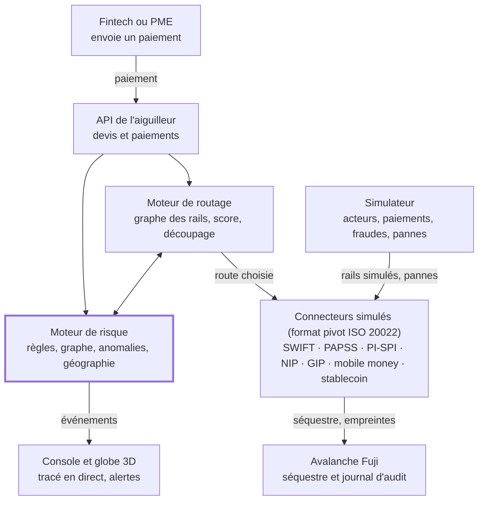

# PRD — L'aiguilleur

10 octobre 2026 · Oscar Hu

## Résumé

L'aiguilleur est un routeur de paiements transfrontaliers pour l'Afrique de l'Ouest : pour chaque paiement, il choisit la route la moins chère et la plus rapide selon l'endroit où se trouvent l'émetteur et le bénéficiaire, et retient la fraude avant que l'argent ne bouge.

- **Problème** : plus de 80 % des paiements transfrontaliers africains passeraient par une banque correspondante aux États-Unis ou en Europe, ce qui ajoute 2 à 5 % par transaction. Les rails (PAPSS, PI-SPI, mobile money) sont des îlots, et chaque institution ne voit que son tronçon : la fraude passe entre les trous.
- **Solution** : un registre géolocalisé des rails, un moteur de routage qui note chaque route (coût, délai, échec, argent utilisable sur place, risque), un moteur de risque qui exploite la vue complète et les signaux géographiques, et une réponse graduée (route rapide, séquestre, retenue, blocage), le tout visible en direct sur un globe où chaque paiement se trace.
- **Périmètre du hackathon** (Secure Horizons, track 1) : le triangle Lagos – Accra – Abidjan, trois monnaies (naira, cedi, franc CFA), sept rails simulés, 50 000 paiements synthétiques avec fraudes injectées, séquestre et journal d'audit sur Avalanche Fuji.
- **Livrables pour le 11 octobre 2026 à 12 h** : dépôt Git avec README, vidéo de démo de 2 à 3 minutes, deck de 8 slides, fiche de défense, plan de réponse et slide conformité.

## Problème terrain

Entre Lagos, Accra et Abidjan, un paiement reste cher, lent et mal relié, et chaque institution n'en voit qu'un tronçon : c'est cette opacité que les fraudeurs exploitent.

| Friction   | Ce qu'on observe                                                                                                                                                                                                                           | Source                                                                                                                                                                                                                                                                                                                                                                                                                                     |
| ---------- | ------------------------------------------------------------------------------------------------------------------------------------------------------------------------------------------------------------------------------------------ | ------------------------------------------------------------------------------------------------------------------------------------------------------------------------------------------------------------------------------------------------------------------------------------------------------------------------------------------------------------------------------------------------------------------------------------------ |
| Coût       | Envoyer 200 $ vers l'Afrique subsaharienne coûte 8,46 % en moyenne (T3 2025), contre 6,36 % dans le monde, et 14,99 % via une banque                                                                                                       | [Banque mondiale](https://remittanceprices.worldbank.org/sites/default/files/2026-04/RPW_main_report_and_annex_Q325.pdf)                                                                                                                                                                                                                                                                                                                   |
| Détour     | Plus de 80 % des paiements transfrontaliers africains passeraient par des correspondants aux États-Unis ou en Europe (estimation non attribuée), ce qui ajoute 2 à 5 % par opération                                                       | [TechCabal](https://techcabal.com/2026/03/31/how-papss-is-meeting-cross-border-promise-four-years-on/)                                                                                                                                                                                                                                                                                                                                     |
| Lenteur    | En Afrique, environ 25 % des paiements SWIFT arrivent en moins d'une heure ; dans le monde, 35,4 % contre 75 % visés par le G20 pour 2027                                                                                                  | [Swift](https://www.swift.com/insights/news/insights-african-payments-landscape) · [FXC Intelligence](https://www.fxcintel.com/research/reports/ct-retail-payments-g20-cross-border-roadmap-2025)                                                                                                                                                                                                                                          |
| Îlots      | PI-SPI relie 175 participants dans les 8 pays de l'UEMOA, mais pas le Nigeria ni le Ghana. PAPSS couvre 28 pays, mais la Côte d'Ivoire n'y est pas encore reliée : un pilote UEMOA est annoncé sans date                                   | [BCEAO](https://www.bceao.int/sites/default/files/2026-10/Communiqu%C3%A9%20du%202%20octobre%202026.pdf) · [Launch Base](https://launchbaseafrica.com/2026/07/09/papss-inches-closer-to-continent-wide-coverage-as-central-african-central-bank-joins/) · [Ecofin](https://www.ecofinagency.com/news-finances/2107-57583-bceao-prepares-papss-pilot-with-more-than-80-west-african-banks)                                                  |
| Plafonds   | Fixés banque par banque : chez FBN Ghana, 2 000 $ par jour pour un particulier sur PAPSS                                                                                                                                                   | [FBN Ghana](https://www.fbnbankghana.com/?p=26359)                                                                                                                                                                                                                                                                                                                                                                                         |
| Géographie | Les francs CFA d'Afrique de l'Ouest et d'Afrique centrale ont la même parité avec l'euro mais ne sont pas interchangeables. La bonne route dépend aussi de la région du bénéficiaire : compte en ville, portefeuille mobile en zone rurale | [Banque de France](https://banque-france.fr/system/files/2024-08/zone-franc.pdf)                                                                                                                                                                                                                                                                                                                                                           |
| Fraude     | Nigeria : 25,85 Md₦ de pertes en 2025 (67 518 cas, 63 % à Lagos). Ghana : 16 733 cas en 2024, dont 94 % chez les prestataires de paiement. Côte d'Ivoire : 12 100 affaires et environ 6,96 Md FCFA de préjudice en 2024                    | [NIBSS](https://nibss-plc.com.ng/nibss-digital-payment-fraud-drops-51-to-%E2%82%A625-85b-in-2025/) · [Banque du Ghana](https://gab.com.gh/assets/images/docs/Overview%20of%20BoG%20Fraud%20Report_UPDATED%20APRIL%202025.pdf) · [KOACI](https://www.koaci.com/article/2025/05/27/cote-divoire/societe/cote-divoire-cybercriminalite-la-plcc-a-enregistre-12100-affaires-en-2024-pour-un-prejudice-de-pres-de-7-milliards-fcfa_187200.html) |

Question ouverte : aucune donnée publique n'a été trouvée sur la liquidité des agents de retrait par région. C'est une hypothèse terrain à valider.

## Utilisateurs et personas

Le client payant est la fintech qui émet les paiements ; l'utilisateur quotidien de la console est son analyste fraude et conformité.

| Persona                       | Qui                                                         | Ce qu'il veut                                                                     | Ce que l'aiguilleur lui apporte                                                            |
| ----------------------------- | ----------------------------------------------------------- | --------------------------------------------------------------------------------- | ------------------------------------------------------------------------------------------ |
| Fintech émettrice             | Plateforme de paiement B2B, société de transfert, néobanque | Moins de frais, plus de paiements qui aboutissent, une seule intégration          | Une API qui note toutes les routes et choisit la meilleure, contrôles inclus               |
| Analyste fraude et conformité | Équipe risque de la fintech                                 | Moins d'alertes inutiles, des dossiers complets, des déclarations dans les délais | Alertes expliquées, chronologie et tracé du paiement sur le globe, déclaration pré-remplie |
| PME expéditrice               | Importateur à Lagos qui paie un fournisseur à Abidjan       | Un prix connu d'avance et un délai fiable                                         | Un devis comparé au détour par le dollar, valable 10 minutes                               |
| Bénéficiaire urbain           | Fournisseur à Accra ou Abidjan                              | Être payé vite sur son compte                                                     | Un crédit instantané via le rail local, nom vérifié                                        |
| Bénéficiaire rural            | Famille dans le nord du Ghana                               | Pouvoir retirer l'argent près de chez elle                                        | Une livraison sur le portefeuille de l'opérateur présent dans sa région                    |

## Objectifs, non-objectifs et indicateurs

Le build doit prouver trois choses mesurées : une route moins chère et plus rapide que le détour par le dollar, une détection fiable avant exécution, et une réponse graduée tracée de bout en bout.

**Objectifs**

1. Battre le détour par le dollar sur le coût et le délai dans le triangle Lagos – Accra – Abidjan.
2. Détecter les fraudes injectées avant l'exécution, avec un gain mesuré grâce aux signaux géographiques.
3. Répondre de façon graduée, avec séquestre sur Avalanche Fuji et journal d'audit vérifiable.

**Non-objectifs**

- Aucune connexion à un vrai rail ni donnée réelle (règlement du hackathon) : tout est simulé.
- Aucune détention de fonds, aucune vérification d'identité réelle, aucune application grand public.
- Aucun corridor hors du triangle.

| Indicateur                                   | Objectif interne                                   | Référence                                                       | Critère du jury       |
| -------------------------------------------- | -------------------------------------------------- | --------------------------------------------------------------- | --------------------- |
| Coût tout compris (frais et écart de change) | ≤ 1 % du montant au-delà de 200 $                  | Cible G20 2027 ; 8,46 % en moyenne vers l'Afrique subsaharienne | Faisabilité           |
| Part créditée en moins d'une heure           | ≥ 75 %                                             | Cible G20 ; 35,4 % aujourd'hui dans le monde                    | Faisabilité           |
| Part utilisable sur place à l'arrivée        | ≥ 95 %                                             | Indicateur propre à l'aiguilleur                                | Qualité de la réponse |
| Rappel par typologie de fraude               | ≥ 85 %                                             | Objectif d'équipe                                               | Détection (30 %)      |
| Faux positifs sur paiements honnêtes         | ≤ 2 %                                              | Objectif d'équipe                                               | Détection (30 %)      |
| Fraudes stoppées avant exécution             | 100 % des fraudes détectées                        | Objectif d'équipe                                               | Détection et réponse  |
| Gain dû à la géographie                      | Écart de rappel à faux positifs égaux              | Comparaison avec et sans signaux géographiques                  | Détection             |
| Latence de décision                          | p95 < 300 ms hors blockchain                       | Objectif d'équipe                                               | Faisabilité           |
| Délai d'affichage                            | < 1 s entre un événement et son tracé sur le globe | Objectif d'équipe                                               | Pitch et démo (15 %)  |
| Décisions rejouables par un auditeur         | 100 %                                              | Journal sur Fuji                                                | Conformité (15 %)     |

## Scénario de démo

La démo tient en 3 minutes sur le globe : deux paiements honnêtes se tracent en direct sur deux routes différentes selon le lieu du bénéficiaire, puis deux fraudes sont retenues avant de quitter la dernière institution.

1. **Le globe** : il tourne avec tout le réseau, correspondants de New York, Londres et Paris compris, puis plonge sur Lagos, Accra, Tamale (nord du Ghana) et Abidjan, avec les rails disponibles, leurs coûts, leurs horaires et leur état.
2. **Paiement fournisseur** : une PME de Lagos paie 3 000 $ à un fournisseur d'Abidjan. Entre pays voisins, le détour par un correspondant prend 3 à 7 jours ouvrés. PAPSS ne relie pas encore la Côte d'Ivoire et le rail stablecoin est désactivé en UEMOA faute de cadre : l'aiguilleur choisit le hub panafricain puis PI-SPI à l'arrivée, et le devis explique pourquoi.
3. **Paiement familial** : le même expéditeur envoie 150 $ à une famille de Tamale. La route change : livraison sur le portefeuille de l'opérateur présent dans la région, là où les agents ont des espèces.
4. **Panne** : le simulateur coupe le rail instantané ghanéen ; le rail passe en pointillés rouges et les paiements suivants se tracent aussitôt sur une autre route.
5. **Faux fournisseur** : le compte du fournisseur d'Abidjan change la veille d'un paiement, et le nom du titulaire ne correspond pas à la facture. Le paiement passe en séquestre : le tracé s'arrête sur un cadenas avant le dernier saut, et l'émetteur doit confirmer.
6. **Réseau de comptes mules** : 40 victimes au Ghana paient vers des portefeuilles vidés en quelques minutes près d'une frontière. La grappe s'allume sur le globe, les paiements sont retenus, un coupe-circuit régional s'active et une déclaration est pré-remplie.
7. **Le bilan** : coût, part créditée en moins d'une heure, part utilisable sur place, précision et rappel, montant retenu, avec et sans signaux géographiques.

Délai entre pays voisins : [Kora](https://www.korahq.com/blog/the-hidden-payment-problem-slowing-intra-african-trade). Cadre UEMOA sur les cryptoactifs : [Ecofin](https://www.ecofinagency.com/news-finances/2407-57691-waemu-cryptoasset-regulation-remains-in-preparation-bceao-urges-caution).

## Expérience : le paiement tracé en direct sur un globe

On voit son paiement voyager en direct : le réseau des institutions et des rails est posé sur un globe 3D, le chemin retenu se dessine dès qu'il est calculé, puis l'argent le parcourt institution par institution. Le globe montre aussi l'argument central : seule une vue d'ensemble du réseau voit une fraude qui traverse plusieurs institutions.

**Le déroulé**

1. Vue d'ensemble : le globe tourne lentement avec tout le réseau et un échantillon du trafic.
2. Envoi : la caméra plonge sur l'émetteur pendant que le routage et le risque calculent.
3. Tracé : le chemin retenu se dessine saut par saut, avec pour chaque saut le rail, le coût et le délai prévus. Aucune autre route n'apparaît.
4. Parcours : l'argent avance à chaque confirmation du simulateur, et une onde part de chaque institution atteinte.
5. Arrivée : une onde verte chez le bénéficiaire, avec le coût final, le délai réel et l'économie face au détour par le dollar.
6. Si le risque l'exige, le tracé s'arrête avant le dernier saut : cadenas pour le séquestre, orange pour la retenue, rouge pour le blocage.

**Ce que montre le globe**

| Couche                  | Ce qu'on voit                                                                                                                                                                          | Calque globe.gl                              |
| ----------------------- | -------------------------------------------------------------------------------------------------------------------------------------------------------------------------------------- | -------------------------------------------- |
| Réseau                  | Institutions en points, villes en étiquettes, rails en arcs fins colorés par type. Les correspondants simulés de New York, Londres et Paris restent visibles : on voit le détour évité | `pointsData`, `labelsData`, `arcsData`       |
| Trafic                  | Un échantillon des paiements synthétiques, en arcs pâles et brefs                                                                                                                      | `arcsData`, tirets animés                    |
| Notre paiement          | Le chemin retenu en trait vif, coloré selon le niveau de risque, puis une comète qui le parcourt                                                                                       | `arcsData`, `ringsData`                      |
| Rail stablecoin         | Un arc plus haut que les autres : il passe par une chaîne publique, pas par un pays                                                                                                    | `arcAltitude`                                |
| Alertes                 | Anneaux rouges sur la région, grappe de retraits en hexagones, trait rouge pour un déplacement impossible                                                                              | `ringsData`, `hexBinPointsData`, `pathsData` |
| Pannes et coupe-circuit | Rail en panne en pointillés rouges ; région sous coupe-circuit teintée pendant 24 h                                                                                                    | `arcsData`, `polygonsData`                   |

**Les événements**

Le globe ne calcule rien : il dessine les événements que l'API publie à chaque étape, chacun avec l'UETR, l'heure et les coordonnées des institutions concernées.

| Événement                          | Ce que fait le globe                                                   |
| ---------------------------------- | ---------------------------------------------------------------------- |
| `route.selected`                   | Dessine le chemin retenu, saut par saut                                |
| `risk.scored`                      | Affiche le score et colore le tracé                                    |
| `hop.sent`                         | Lance la comète sur le saut                                            |
| `hop.settled`                      | Fait partir une onde de l'institution atteinte                         |
| `escrow.locked`, `escrow.released` | Pose un cadenas avant le dernier saut, puis l'ouvre                    |
| `payment.held`, `payment.blocked`  | Fige le tracé en orange ou en rouge et ouvre le dossier                |
| `payment.credited`                 | Onde verte chez le bénéficiaire, avec le bilan coût, délai et économie |
| `alert.raised`                     | Anneaux, grappe ou déplacement impossible sur la région                |
| `rail.down`, `rail.up`             | Met le rail en pointillés rouges, puis le rétablit                     |
| `breaker.on`, `breaker.off`        | Teinte la région, puis la libère                                       |

**Règles d'affichage**

- Une seule route visible par paiement : celle qui a été retenue.
- La couleur suit les seuils du moteur de risque : vert (faible), ambre (moyen), orange (élevé), rouge (critique).
- Les rails instantanés s'affichent à leur vitesse réelle. Au-delà de 10 s (règlement PAPSS différé, correspondant), le temps est accéléré et une horloge indique le délai réel simulé.
- Le globe ne montre que des régions et des institutions, jamais la position précise d'une personne.
- Un fil texte à côté du globe reprend chaque événement avec son heure : tout se suit sans l'animation, et le jury peut lire les détails.

**Technique**

- react-globe.gl 2.38 (sur globe.gl et three.js), chargé dans un composant client avec `next/dynamic` et `ssr: false` : WebGL n'existe pas côté serveur, et Next.js refuse `ssr: false` dans un composant serveur.
- Flux par Server-Sent Events : `EventSourceResponse` et `ServerSentEvent`, natifs dans FastAPI depuis la 0.135, et `EventSource` côté navigateur. Le sens unique suffit : le globe ne fait qu'écouter.
- Un seul flux pour toute la console : en HTTP/1.1, un navigateur limite à 6 les connexions SSE ouvertes par domaine. Chaque événement porte un `id`, que le navigateur renvoie à la reconnexion pour reprendre où il en était.
- Textures de la Terre (fournies dans le paquet three-globe) et frontières Natural Earth servies en local : la démo ne dépend pas du Wi-Fi.
- Objectif d'équipe : 60 images par seconde sur l'ordinateur de démo, avec au plus 200 arcs animés en même temps.
- Plan B : la vidéo de démo enregistrée samedi soir ; le fil texte marche même sans WebGL.

Sources : [globe.gl](https://github.com/vasturiano/globe.gl) · [react-globe.gl](https://github.com/vasturiano/react-globe.gl) · [FastAPI, Server-Sent Events](https://fastapi.tiangolo.com/tutorial/server-sent-events/) · [MDN, EventSource](https://developer.mozilla.org/en-US/docs/Web/API/EventSource) · [Next.js, chargement différé](https://nextjs.org/docs/app/guides/lazy-loading)

## Exigences fonctionnelles

Neuf modules sont indispensables à la démo (P0) ; trois autres s'ajoutent si le temps le permet.

| ID  | Module                 | Exigence                                                                                                                                                                               | Priorité |
| --- | ---------------------- | -------------------------------------------------------------------------------------------------------------------------------------------------------------------------------------- | -------- |
| F1  | Registre des rails     | Registre des institutions, rails et régions, avec coûts, délais, plafonds, horaires en UTC, couverture et état en temps réel                                                           | P0       |
| F2  | Devis et routage       | Pour chaque demande, une seule route, la meilleure, avec sa raison en une ligne ; découpage automatique si un plafond l'impose                                                         | P0       |
| F3  | Interopérabilité       | Format pivot inspiré du message ISO 20022 pacs.008, un connecteur simulé par rail, annuaire d'alias                                                                                    | P0       |
| F4  | Vérification du nom    | Comparaison du nom attendu et du nom du titulaire avant l'envoi                                                                                                                        | P0       |
| F5  | Moteur de risque       | Score de 0 à 100 par paiement, avant exécution, en moins de 300 ms                                                                                                                     | P0       |
| F6  | Réponse graduée        | Quatre niveaux d'action et coupe-circuit par région ou par corridor                                                                                                                    | P0       |
| F7  | Console analyste       | File d'alertes, dossier avec chronologie, tracé sur le globe et preuves, actions libérer, retenir, bloquer et déclarer                                                                 | P0       |
| F8  | Simulateur             | Acteurs, paiements, fraudes et pannes générés à partir d'une graine, donc rejouables                                                                                                   | P0       |
| F12 | Globe en direct        | Réseau des institutions et des rails sur un globe 3D ; chaque paiement s'y trace en direct, saut par saut, à partir du flux d'événements ; alertes géographiques visibles sur le globe | P0       |
| F9  | Séquestre et journal   | Contrat de séquestre et empreinte de chaque décision sur Avalanche Fuji                                                                                                                | P1       |
| F10 | Déclaration de soupçon | Brouillon pré-rempli pour la cellule de renseignement financier du pays                                                                                                                | P1       |
| F11 | Résumé IA du dossier   | Un LLM rédige le résumé de l'alerte sans jamais décider ; les textes des paiements sont traités comme des données                                                                      | P2       |

P0 : indispensable à la démo. P1 : prêt avant dimanche 6 h. P2 : bonus.

## Spécification du routage

Chaque route reçoit un score unique qui additionne son coût, son délai, ses risques d'échec et de livraison inutilisable, et son risque de fraude ; le score le plus bas gagne, et seule cette route est renvoyée.

**Le graphe**

- Nœuds : un couple institution et région, avec sa monnaie et ses coordonnées (GeoNames ou Natural Earth).
- Arêtes : les rails, avec frais fixes, frais en %, écart de change, délai médian et p95, plafonds par opération et par jour, horaires en UTC, justificatifs exigés et état (ouvert, congestionné, en panne).

**Le score d'une route r pour un paiement p**

```math
S(r, p) = C(r) + \lambda \, T(r) + \mu \, K \, P_{\mathrm{echec}}(r) + \nu \, K \, P_{\mathrm{inutil}}(r) + \rho \, R(r, p)
```

- C : coût tout compris, en % du montant (frais et écart de change par rapport au taux moyen).
- T : délai attendu en heures, heures limites et fuseaux compris.
- P échec : probabilité d'échec (plafond, liquidité, justificatif manquant) ; K : coût d'un échec.
- P inutil : probabilité que l'argent ne soit pas utilisable dans la région du bénéficiaire.
- R : risque de fraude du paiement sur cette route, fourni par le moteur de risque.
- λ, μ, ν, ρ : poids réglables par client ; un paiement fournisseur urgent n'a pas les poids d'un envoi familial.

**L'algorithme**

1. Filtrer les rails fermés, en panne, hors plafond ou interdits dans le pays (par exemple le rail stablecoin en UEMOA).
2. Calculer les 5 meilleurs chemins par coût avec l'algorithme de Yen (`networkx.shortest_simple_paths`).
3. Noter chaque chemin avec S et ne renvoyer que le meilleur, avec sa raison en une ligne ; les autres chemins et leurs scores restent dans le journal d'audit.
4. Si le montant dépasse un plafond ou la liquidité disponible, répartir le paiement par flot à coût minimal (OR-Tools `SimpleMinCostFlow`, poids entiers) et étiqueter ces découpages comme techniques.
5. Garder le devis valable 600 secondes, comme Nexus pour ses cotations de change.

**Les règles géographiques**

- Rester dans la zone monétaire quand c'est possible : d'Abidjan à Dakar, PI-SPI sans change.
- Prendre l'euro comme pont pour le franc CFA, fixé à 655,957 FCFA pour 1 €.
- Livrer sur le rail présent dans la région du bénéficiaire, pondéré par un indice de liquidité des agents (hypothèse simulée).
- Tenir compte des fuseaux : Lagos est en UTC+1, Accra et Abidjan en UTC+0 ; PAPSS règle les soldes nets à 11 h UTC.
- Garder PAPSS fermé vers la Côte d'Ivoire tant que le pilote PAPSS – PI-SPI n'est pas ouvert, avec un interrupteur pour la démo.
- Rerouter dès qu'un rail tombe en panne, et revenir quand il se rétablit.

Sources : [Nexus Global Payments](https://docs.nexusglobalpayments.org/fx-provision/quotes.md) · [networkx](https://networkx.org/documentation/stable/reference/algorithms/generated/networkx.algorithms.simple_paths.shortest_simple_paths.html) · [OR-Tools](https://developers.google.com/optimization/flow/mincostflow) · [Direction générale du Trésor](https://www.tresor.economie.gouv.fr/tresor-international/la-zone-franc/les-principes-et-modalites-de-fonctionnement-de-la-cooperation-monetaire) · [PAPSS](https://papss.com/how-it-works/)

## Spécification du moteur de risque

Chaque paiement reçoit un score de 0 à 100 avant exécution, en moins de 300 ms. Ce score combine des règles, le graphe des flux, une détection d'anomalies et des signaux géographiques.

| Typologie                      | Signaux principaux                                                                                                      | Pourquoi elle est retenue                                                                                                                                                                                                                                                                                                    |
| ------------------------------ | ----------------------------------------------------------------------------------------------------------------------- | ---------------------------------------------------------------------------------------------------------------------------------------------------------------------------------------------------------------------------------------------------------------------------------------------------------------------------- |
| Réseau de comptes mules        | Afflux depuis plusieurs pays vers un portefeuille, vidage en quelques minutes, retraits concentrés chez quelques agents | Le GAFI décrit des mules recrutées par de fausses offres d'emploi et des fonds qui transitent très vite ([GAFI](https://www.fatf-gafi.org/content/dam/fatf-gafi/reports/Illicit-financial-flows-cyber-enabled-fraud.pdf.coredownload.inline.pdf))                                                                            |
| Fractionnement sous les seuils | Montants répétés juste sous un plafond ou un seuil de déclaration, répartis sur plusieurs comptes                       | Signalé par la cellule ghanéenne en mai 2025 ([FIC](https://fic.gov.gh/images/2026/Advisory_Notice_-_1.pdf))                                                                                                                                                                                                                 |
| Faux fournisseur               | Nom du titulaire différent de la facture, compte créé ou modifié récemment, urgence                                     | Le GIABA classe la messagerie compromise parmi les typologies régionales ([Droit Médias Finance](https://droitmediasfinance.com/index.php/actualites/droit-tech-fintech/1006-lutte-anti-blanchiment-cybersecurite-le-giaba-rapporte-sur-7-types-de-blanchiment-de-capitaux-lies-a-la-cybercriminalite-en-afrique-de-louest)) |
| Prise de contrôle et SIM swap  | Carte SIM changée récemment, appareil ou pays inhabituel, déplacement impossible                                        | Score de prévalence de 78,85 % pour le SIM swap chez les opérateurs interrogés ([GSMA](https://www.gsma.com/mobilefordevelopment/wp-content/uploads/2024/03/GSMA-Fraud-Typologies-04-03-24.pdf))                                                                                                                             |
| Victime d'arnaque              | Premier envoi vers ce corridor, montant inhabituel, bénéficiaire déjà signalé                                           | 88 000 victimes recensées lors de l'opération Serengeti 2.0 ([Interpol](https://www.interpol.int/News-and-Events/News/2025/African-authorities-dismantle-massive-cybercrime-and-fraud-networks-recover-millions))                                                                                                            |
| Collusion d'agent              | Dépôts découpés près des paliers de commission, grappes d'agents isolées                                                | 76 % des dépôts près des paliers chez ces agents, contre 18 % en moyenne ([arXiv](https://arxiv.org/pdf/1910.05596))                                                                                                                                                                                                         |

**Les signaux géographiques**

- Distance entre la localisation grossière de l'appareil et celle du compte.
- Déplacement impossible : deux opérations trop éloignées pour le temps écoulé (vitesse implicite supérieure à 900 km/h).
- Portefeuille ouvert dans une région et vidé dans une autre.
- Retraits d'une grappe de comptes concentrés chez quelques agents ou dans une zone frontalière.
- Vague de fraude en cours dans la région ou le corridor.

**Les modèles**

1. Règles déterministes : vérification du nom, listes de sanctions synthétiques, seuils.
2. Indicateurs de graphe : entrées et sorties multiples, cycles courts (`networkx.simple_cycles`), temps de passage sur un compte.
3. Détection d'anomalies : IsolationForest de scikit-learn, ou PyOD.
4. Modèle supervisé (gradient boosting) entraîné sur une graine du simulateur et testé sur une autre, pour éviter les fuites de données.

**Les seuils**, réglables : 0 à 39 faible, 40 à 69 moyen, 70 à 89 élevé, 90 à 100 critique. Chaque alerte affiche ses trois signaux les plus forts.

Signaux de localisation dans l'industrie : [Microsoft Entra](https://learn.microsoft.com/en-us/entra/id-protection/concept-identity-protection-risks) · [API CAMARA SIM Swap](https://developers.opengateway.telefonica.com/docs/simswap) · [Règlement UE 2018/389, art. 18](https://www.legislation.gov.uk/eur/2018/389/article/18)

## Plan de réponse

La réponse suit le score : plus le risque monte, plus l'argent est retenu tôt, et toute action lourde passe par un humain.

| Niveau              | Action automatique                                                                                                                                 | Action humaine                                                        | Délai à tenir                                                                           |
| ------------------- | -------------------------------------------------------------------------------------------------------------------------------------------------- | --------------------------------------------------------------------- | --------------------------------------------------------------------------------------- |
| Faible (0 à 39)     | Route la plus rapide et la moins chère                                                                                                             | Aucune                                                                | Immédiat                                                                                |
| Moyen (40 à 69)     | Vérification du nom, données complètes de l'émetteur et du bénéficiaire, séquestre libéré quand le bénéficiaire confirme depuis la région attendue | Analyste alerté si le séquestre dépasse 2 h                           | Objectif d'équipe : 2 h                                                                 |
| Élevé (70 à 89)     | Paiement retenu avant exécution, confirmation demandée à l'émetteur par un autre canal                                                             | L'analyste libère, prolonge ou bloque                                 | Objectif d'équipe : 2 h ouvrées                                                         |
| Critique (90 à 100) | Blocage, dossier et déclaration de soupçon pré-remplis                                                                                             | L'analyste valide et transmet à la cellule de renseignement financier | Nigeria et Ghana : 24 h. Côte d'Ivoire : avant exécution, confirmation écrite sous 48 h |

**Le coupe-circuit régional** : quand une grappe de fraude touche une région ou un corridor, les seuils y baissent de 20 points pendant 24 h. Seul un humain peut le lever plus tôt.

**Qui est prévenu**

- L'analyste de la fintech émettrice, dans la console.
- L'institution destinataire, par un message d'alerte qui porte l'identifiant unique du paiement (UETR).
- La cellule de renseignement financier, uniquement par l'analyste.
- Jamais le client visé par une déclaration : la loi ivoirienne l'interdit explicitement.

**La trace** : chaque action est horodatée, rattachée à la version des règles et du modèle, et son empreinte est écrite sur Avalanche Fuji.

Sources : [loi nigériane de 2022 sur le blanchiment](https://lawpadi.com/wp-content/uploads/2023/03/Money-Laundering-Prevention-and-Prohibition-Act-2022.pdf) · [FIC Ghana](https://fic.gov.gh/report-types.html) · [loi ivoirienne 2016-992](https://loidici.biz/?p=6083)

## Architecture technique

_Chaque paiement est noté pour son risque avant de toucher un rail._



Le paiement entre par l'API, passe par le routage et le risque, puis seulement par un connecteur ; le simulateur alimente les rails, et Fuji garde le séquestre et la trace. Chaque étape publie un événement, que le globe reçoit en direct.

| Composant                        | Technologie                                                                                                          |
| -------------------------------- | -------------------------------------------------------------------------------------------------------------------- |
| API, routage, risque, simulateur | Python 3.12, FastAPI (flux SSE natif), networkx, OR-Tools, scikit-learn, PyOD                                        |
| Stockage                         | SQLite pour la démo, Postgres en option                                                                              |
| Console et globe                 | Next.js, react-globe.gl 2.38 (globe.gl, three.js), textures three-globe et frontières Natural Earth servies en local |
| Contrats                         | Solidity, Foundry, OpenZeppelin 5.x, Avalanche Fuji (chaîne 43113, RPC `https://api.avax-test.network/ext/bc/C/rpc`) |
| Lien API – Fuji                  | viem ou web3.py ; toujours attendre le reçu de transaction depuis la mise à jour Helicon                             |
| Résumé IA                        | API d'un LLM, sortie en texte seul, sans aucune action                                                               |
| Déploiement                      | Docker Compose, crédits AWS fournis par le hackathon                                                                 |

Sources : [Avalanche Fuji](https://build.avax.network/docs/quick-start/networks/fuji-testnet) · [Helicon](https://docs.avax.network/docs/primary-network/helicon-upgrade) · [Natural Earth](https://www.naturalearthdata.com/about/terms-of-use/) · [react-globe.gl](https://github.com/vasturiano/react-globe.gl) · [FastAPI, Server-Sent Events](https://fastapi.tiangolo.com/tutorial/server-sent-events/)

## Modèle de données et API

Le format pivot reprend les champs du message ISO 20022 pacs.008, et l'API couvre six usages : devis, paiement, suivi, flux en direct, annuaire et dossiers.

**Entités**

| Entité      | Champs clés                                                                                                                                                                            |
| ----------- | -------------------------------------------------------------------------------------------------------------------------------------------------------------------------------------- |
| Institution | id, nom, type (banque, émetteur de monnaie électronique, opérateur mobile money, rampe stablecoin), pays, régions couvertes, identifiant (BIC ou code local)                           |
| Rail        | id, type, monnaies, frais fixes, frais en %, écart de change, délai p50 et p95, plafonds par opération et par jour, horaires UTC, justificatifs, état, pays où il est autorisé         |
| Région      | id, pays, coordonnées, opérateur dominant, indice de liquidité des agents (simulé)                                                                                                     |
| Paiement    | uetr (UUID v4), montant, devises, émetteur et bénéficiaire pseudonymisés, alias du bénéficiaire, régions de l'émetteur et du bénéficiaire, objet, route choisie, score, niveau, statut |
| Étape       | uetr, rail, rang, institutions de départ et d'arrivée, horodatages, statut                                                                                                             |
| Dossier     | id, paiements liés, typologie, score, signaux, actions, décision humaine, empreinte sur Fuji                                                                                           |
| Décision    | id, uetr, version des règles, version du modèle, empreinte des preuves, transaction Fuji                                                                                               |

**Format pivot**, sous-ensemble de pacs.008.001.08 : `UETR` obligatoire (36 caractères, inchangé sur toute la chaîne), `Dbtr`, `DbtrAgt`, `Cdtr`, `CdtrAgt`, `IntrmyAgt1`, `InstdAmt`, `XchgRate`, `ChrgBr` (DEBT, CRED ou SHAR), `Purp`, `RmtInf/Ustrd` (140 caractères au plus). Les adresses sont structurées avec ville et pays : Swift annonce le rejet possible des adresses non structurées, avec un calendrier en cours de révision.

**API**

| Méthode et route                                 | Rôle                                                                                                                                                                              |
| ------------------------------------------------ | --------------------------------------------------------------------------------------------------------------------------------------------------------------------------------- |
| `POST /v1/quotes`                                | Reçoit montant, devises, alias et région du bénéficiaire ; renvoie la meilleure route et sa raison, valable 600 s                                                                 |
| `POST /v1/payments`                              | Exécute un devis ; renvoie l'UETR, le score, le niveau et l'action prise                                                                                                          |
| `GET /v1/payments/{uetr}`                        | Statut étape par étape, sur le modèle du rapport pacs.002                                                                                                                         |
| `GET /v1/stream`                                 | Flux d'événements en direct (Server-Sent Events) : route choisie, score, sauts, séquestre, alertes, pannes, chacun avec l'UETR, l'heure et les coordonnées ; il alimente le globe |
| `GET /v1/directory/{alias}`                      | Résout un alias (téléphone, compte) en rail, institution, région et nom masqué                                                                                                    |
| `POST /v1/name-check`                            | Compare le nom attendu au nom du titulaire, comme la recherche de nom de l'API mobile money de la GSMA                                                                            |
| `GET /v1/cases` et `POST /v1/cases/{id}/actions` | File d'alertes ; actions libérer, retenir, bloquer et déclarer                                                                                                                    |
| `POST /v1/sim/events`                            | Injecte une panne ou une vague de fraude pour la démo                                                                                                                             |
| `GET /v1/metrics`                                | Indicateurs de la démo, avec et sans signaux géographiques                                                                                                                        |

Sources : [Nexus, pacs.008](https://docs.nexusglobalpayments.org/messaging-and-translation/message-pacs.008-fi-to-fi-customer-credit-transfer.md) · [BNY, guide pacs.008](https://www.bnymellon.com/content/dam/bnymellon/documents/pdf/iso-20022/Module%204_December2020_pacs008.pdf) · [Swift, adresses structurées](https://www.swift.com/de/node/310619) · [GSMA Mobile Money API 1.2](https://www.gsma.com/mobilefordevelopment/wp-content/uploads/2021/10/Mobile-Money-API-Specification-1.2.0-Master.pdf)

## Données synthétiques et paramètres de simulation

Le simulateur rejoue 30 jours de flux dans le triangle à partir d'une graine. Les paramètres des rails viennent de sources publiques et restent des ordres de grandeur.

| Rail                             | Délai simulé                                                       | Coût simulé                                                                                      | Plafonds                                                                     | Disponibilité                       | Portée dans le triangle                                         |
| -------------------------------- | ------------------------------------------------------------------ | ------------------------------------------------------------------------------------------------ | ---------------------------------------------------------------------------- | ----------------------------------- | --------------------------------------------------------------- |
| Correspondant SWIFT (dollar)     | 25 % en moins d'1 h, 52 % de plus en 24 h, le reste en 2 à 5 jours | 1 % (min 10 $), plus 25 $ de frais SWIFT, plus 2 à 5 % de détour                                 | Aucun publié                                                                 | Jours ouvrés, heures limites        | Les trois pays                                                  |
| PAPSS                            | 120 s annoncées, parfois le lendemain                              | 3 % (min 5 $, max 50 $) chez UBA Ghana                                                           | 2 000 $ par jour pour un particulier chez FBN Ghana                          | 24/7, soldes nets réglés à 11 h UTC | Nigeria et Ghana ; Côte d'Ivoire fermée (pilote)                |
| PI-SPI                           | Instantané, irrévocable                                            | Gratuit jusqu'à 8 000 FCFA par jour, puis 0 à 0,8 % (dès le 2 novembre 2026)                     | 5 M FCFA par opération (source secondaire)                                   | 24/7                                | Côte d'Ivoire : 38 participants, dont Orange, MTN, Moov et Wave |
| NIP (Nigeria)                    | 2 à 5 s                                                            | Barème de la banque centrale en projet : gratuit jusqu'à 5 000 ₦                                 | Fixés par chaque banque                                                      | 24/7                                | Nigeria, avec vérification du nom                               |
| GIP (Ghana)                      | Quelques secondes                                                  | 0,75 % plafonné à 5 GH₵ (MoMo vers banque, MTN)                                                  | Portefeuilles : 3 000 à 25 000 GH₵ par jour selon le niveau d'identification | 24/7                                | Ghana, avec vérification du nom du compte et du portefeuille    |
| Hub mobile money transfrontalier | Instantané (pilote Onafriq – PAPSS)                                | 4 % (MTN, Ghana vers Nigeria, 2025) ; 1,5 % au plus (Wave, 2022)                                 | Selon le niveau d'identification                                             | 24/7                                | Nigeria vers Ghana (pilote) ; portefeuilles ivoiriens           |
| Stablecoin (USDC, EURC)          | Minutes à heures                                                   | Écart médian de 2,99 % (janvier 2026) ; 1,5 à 4 % si plusieurs acteurs, plus de 13 % en monopole | Aucun publié                                                                 | 24/7                                | Nigeria et Ghana via partenaires agréés ; désactivé en UEMOA    |

**Change** : 1 € = 655,957 FCFA (parité fixe) ; environ 1 332,75 ₦ pour 1 $ (7 octobre 2026) ; environ 11,55 GH₵ pour 1 $ (septembre 2026) ; environ 583 FCFA pour 1 $ (début octobre 2026).

**Acteurs et volumes** (hypothèses du simulateur)

- 3 pays, 7 institutions, 12 régions (par pays : la capitale, deux villes et une zone rurale), coordonnées GeoNames ; plus 3 banques correspondantes simulées à New York, Londres et Paris pour le rail SWIFT.
- 20 000 émetteurs, 30 000 bénéficiaires, 50 000 paiements sur 30 jours.
- Montants log-normaux : médiane de 2 000 $ en B2B, de 150 $ pour les envois familiaux.

**Fraudes injectées** (environ 2 % des paiements) : les six typologies du moteur de risque, en campagnes datées et en grappes géographiques. Bruit honnête : nouveaux bénéficiaires légitimes, vrais voyages, pics saisonniers, salaires découpés.

**Bases de comportement** : PaySim, construit à partir d'un mois de journaux d'un service de mobile money africain, pour les distributions ; les motifs de blanchiment d'IBM AMLworld (entrées et sorties multiples, cycles, dispersion puis regroupement) pour les grappes.

Sources : [Swift](https://www.swift.com/insights/news/insights-african-payments-landscape) · [UBA Ghana, tarifs](https://www.ubaghana.com/wp-content/uploads/sites/14/2026/04/Tariff-Guide-2025.pdf) · [PAPSS](https://papss.com/how-it-works/) · [FBN Ghana](https://www.fbnbankghana.com/?p=26359) · [BCEAO](https://www.bceao.int/sites/default/files/2026-10/Communiqu%C3%A9%20du%202%20octobre%202026.pdf) · [Daba Finance](https://dabafinance.com/en/news/wave-rejoint-le-reseau-de-paiement-instantane-pi-spi-de-la-bceao-2026-10-02) · [NIBSS](https://nibss-plc.com.ng/nibss-instant-payment/) · [TechCabal, barème NIP](https://techcabal.com/?p=186687) · [3News](https://www.3news.com/news/mtn-ghana-to-charge-075percent-fee-on-momo-to-bank-transfers-from-june-1-2026) · [GGEA](https://ggea.net/news/bog-revises-balance-transaction-limits-of-mobile-money-wallets-upwards-starting-march-1/) · [Onafriq](https://onafriq.com/article/onafriq-partners-with-papss-to-launch-the-first-wallet-based-outbound-payments-pilot-from-nigeria-to-ghana-in-partnership-with-banks-and-mobile-money-operators) · [Dubawa](https://ghana.dubawa.org/ghana-to-nigeria-momo-transactions-now-possible/) · [Osiris](https://osiris.sn/transferts-d-argent-transfrontaliers-wave-repousse-les-frontieres-de-l.html) · [Cointelegraph](https://regional-front.cointelegraph.com/news/africa-stablecoin-fx-spreads-january-data) · [Nairametrics](https://nairametrics.com/2026/10/08/naira-slips-to-n1332-75-as-nfem-turnover-hits-1-01-billion/) · [MyJoyOnline](https://myjoyonline.com/cedi-depreciation-hits-9-5-as-renewed-fx-pressure-weighs-on-currency) · [Capmad](https://www.capmad.com/article/transferts-electroniques-la-bceao-instaure-la-gratuite-jusqua-8-000-fcfa-dans-luemoa) · [PaySim](https://www.kaggle.com/datasets/ealaxi/paysim1) · [IBM AMLworld](https://www.kaggle.com/datasets/ealtman2019/ibm-transactions-for-anti-money-laundering-aml)

## Évaluation

On mesure sur une graine de simulation jamais vue pendant l'entraînement, face à trois références, et on isole l'apport de la géographie.

**Protocole**

1. Régler les seuils et entraîner les modèles sur la graine A (30 jours).
2. Évaluer sur la graine B, avec d'autres campagnes de fraude et d'autres pannes.
3. Publier les résultats par typologie, et sur 5 graines si le temps le permet.

**Références**

- Routage habituel : tout paiement transfrontalier passe par un correspondant en dollars.
- Routage le moins cher, sans risque ni géographie.
- Détection par institution isolée : chaque institution ne voit que ses propres étapes.

**Mesures**

| Mesure                           | Définition                                                                         |
| -------------------------------- | ---------------------------------------------------------------------------------- |
| Coût tout compris                | (frais + écart de change par rapport au taux moyen) ÷ montant                      |
| Part en moins d'une heure        | Paiements crédités moins de 60 min après l'ordre ÷ paiements                       |
| Part utilisable sur place        | Paiements livrés sur un rail présent dans la région du bénéficiaire ÷ paiements    |
| Précision, rappel, faux positifs | Par typologie, au seuil retenu                                                     |
| Délai de détection               | Temps entre le premier acte frauduleux d'une campagne et la première alerte        |
| Montant retenu                   | Montant frauduleux stoppé avant la dernière institution ÷ montant frauduleux total |
| Gain dû à la géographie          | Rappel avec signaux géographiques moins rappel sans, à taux de faux positifs égal  |
| Latence                          | p95 du temps de décision, routage et risque compris                                |

## Conformité, vie privée et explicabilité

La conformité est intégrée à la conception : données minimales, décisions lourdes validées par un humain, et chaque décision rejouable par un auditeur.

| Cadre                                                                       | Ce qu'il exige                                                                                                                                                                                                       | Ce que fait l'aiguilleur                                                                            |
| --------------------------------------------------------------------------- | -------------------------------------------------------------------------------------------------------------------------------------------------------------------------------------------------------------------- | --------------------------------------------------------------------------------------------------- |
| Recommandation 16 du GAFI (révisée en juin 2025, applicable d'ici fin 2030) | Au-delà de 1 000 $ ou € entre particuliers d'un pays à l'autre : nom, adresse et date de naissance de l'émetteur ; nom, compte, pays et ville du bénéficiaire ; un contrôle nom-compte ou un suivi côté destinataire | Format pivot enrichi, vérification du nom avant l'envoi                                             |
| Nigeria, cellule NFIU (loi de 2022)                                         | Déclaration de soupçon sous 24 h ; transferts de plus de 10 000 $ déclarés sous un jour                                                                                                                              | Dossier pré-rempli, compte à rebours visible                                                        |
| Ghana, FIC (loi 1044)                                                       | Déclaration de soupçon sous 24 h ; transferts de plus de 1 000 $ déclarés                                                                                                                                            | Dossier pré-rempli, compte à rebours visible                                                        |
| Côte d'Ivoire, CENTIF (loi 2016-992)                                        | Déclarer avant d'exécuter, sinon sans délai ; confirmation écrite sous 48 h ; interdiction de prévenir le client                                                                                                     | Retenue avant exécution aux niveaux élevé et critique ; aucune notification au client               |
| Nigeria, protection des données (loi de 2023)                               | La localisation est une donnée personnelle ; transfert hors du pays sur adéquation ou exception ; droit de s'opposer à une décision purement automatisée ; violation notifiée sous 72 h                              | Région seulement, jamais de GPS ; pseudonymes ; blocages validés par un humain                      |
| Ghana, protection des données (loi 843)                                     | Les pays de destination sont déclarés lors de l'enregistrement                                                                                                                                                       | Traitements séparés par pays, destinations déclarées                                                |
| Côte d'Ivoire, protection des données (loi 2013-450)                        | Transfert vers un pays à protection équivalente, après autorisation de l'ARTCI ; systèmes de géolocalisation déclarés                                                                                                | Données ivoiriennes hébergées en Côte d'Ivoire dans la version cible ; démo entièrement synthétique |
| Stablecoins                                                                 | Nigeria : actifs numériques sous l'autorité de la SEC, projet de règles sur les stablecoins en août 2026. Ghana : loi 1154, licences attendues en 2027. UEMOA : aucun cadre                                          | Rail activé pays par pays, uniquement via des partenaires agréés                                    |

**Explicabilité** : chaque devis donne la route retenue et sa raison, et le journal garde les routes écartées avec leurs scores pour l'auditeur ; chaque alerte affiche ses trois signaux les plus forts. L'empreinte des preuves et les versions des règles et du modèle sont écrites sur Fuji, ce qui permet à un auditeur de rejouer la décision.

**Règles du hackathon** : aucune donnée réelle, aucune action sur un vrai système, aucun secret dans le dépôt (clés en variables d'environnement, fichier `.env` exclu de Git).

Sources : [GAFI, R16](https://www.fatf-gafi.org/en/publications/Fatfrecommendations/update-Recommendation-16-payment-transparency-june-2025.html) · [Mayer Brown](https://www.mayerbrown.com/en/insights/publications/2025/08/fatf-revises-aml-standards-for-certain-funds-transfers) · [loi nigériane de 2022](https://lawpadi.com/wp-content/uploads/2023/03/Money-Laundering-Prevention-and-Prohibition-Act-2022.pdf) · [FIC Ghana](https://fic.gov.gh/report-types.html) · [loi ivoirienne 2016-992](https://loidici.biz/?p=6083) · [loi nigériane de 2023 sur les données](https://www.dataguidance.com/sites/default/files/data_protection_act_2023.pdf) · [loi ghanéenne 843](https://ghalii.org/akn/gh/act/2012/843/eng@2012-05-18) · [DLA Piper, Côte d'Ivoire](https://www.dlapiperdataprotection.com/?c=CI&t=law) · [CIO Mag, ARTCI](https://cio-mag.com/cote-divoire-artci-le-traitement-des-donnees-personnelles-desormais-soumis-a-une-autorisation-prealable) · [Mariblock, Nigeria](https://www.mariblock.com/nigerias-president-signs-bill-recognizing-digital-assets-into-law) · [Serrari, stablecoins au Nigeria](https://serrarigroup.com/nigeria-stablecoin-rules-set-120-liquidity-coverage-floor/) · [Mariblock, Ghana](https://www.mariblock.com/stories/ghana-sets-up-five-agency-committee-to-roll-out-crypto-law-with-licenses-still-a-year-off) · [Ecofin, UEMOA](https://www.ecofinagency.com/news-finances/2407-57691-waemu-cryptoasset-regulation-remains-in-preparation-bceao-urges-caution)

## Fiche de défense

Le scénario de menace combine un réseau de comptes mules transfrontalier et une fraude au faux fournisseur dans le triangle Lagos – Accra – Abidjan.

| Fonction NIST CSF 2.0 | Ce que couvre l'aiguilleur                                                       |
| --------------------- | -------------------------------------------------------------------------------- |
| Gouverner             | Règles et poids versionnés, journal des décisions sur Fuji                       |
| Identifier            | Globe des institutions, rails et régions, avec leur état en direct               |
| Protéger              | Vérification du nom, séquestre, rails désactivés là où ils ne sont pas autorisés |
| Détecter              | Moteur de risque avant exécution, signaux géographiques, vue de bout en bout     |
| Répondre              | Réponse graduée, coupe-circuit régional, déclaration pré-remplie                 |
| Récupérer             | Reroutage en cas de panne, scénarios rejouables à partir d'une graine            |

**Techniques MITRE ATT&CK concernées** : T1657 (vol financier), T1566 (hameçonnage, à l'origine des faux fournisseurs), T1078 (comptes valides détournés), T1451 (SIM swap, matrice mobile).

**Mesures à reporter** : celles de la section Évaluation, sur la graine B.

**Limites connues**

- Données entièrement synthétiques ; paramètres des rails tirés en partie de sources secondaires.
- PAPSS ne relie pas encore la Côte d'Ivoire, et le pilote avec PI-SPI n'a pas de date.
- La liquidité des agents par région n'est pas mesurée : c'est une hypothèse simulée.
- Aucun rail réel n'est connecté, et le rail stablecoin dépend de régimes encore en construction.

## Plan de build et rôles

_Le socle doit tourner avant le point d'étape de 18 h 30._

| Créneau             | Étape             | Contenu                                                                        |
| ------------------- | ----------------- | ------------------------------------------------------------------------------ |
| Sam. 17 h – 18 h 30 | Socle             | Simulateur, contrats déployés sur Fuji, squelette de l'API, globe vide         |
| Sam. 18 h 30        | **Point d'étape** | Formulaire problème, solution, stack                                           |
| Sam. 18 h 30 – 0 h  | Moteurs           | Routage (Yen, score, découpage), risque (règles, graphe, géo), globe en direct |
| Dim. 0 h – 6 h      | Intégration       | Séquestre et coupe-circuit, journal d'audit, scénario de démo rejouable        |
| Dim. 6 h – 10 h     | Mesures et démo   | Métriques sur la graine B, apport de la géographie, vidéo de 2 à 3 min         |
| Dim. 10 h – 12 h    | Livrables         | Deck de 8 slides, fiche de défense, plan de réponse, slide conformité, README  |
| Dim. 12 h et 13 h   | **Gel et jury**   | Gel des livrables à 12 h, passage devant le jury à 13 h                        |

Le socle doit tourner à 18 h 30 ; tout ce qui n'est pas P0 attend que la démo marche de bout en bout.

| Rôle                      | Modules         | Prêt à 18 h 30                                                      | Prêt dimanche à 10 h                                                                     |
| ------------------------- | --------------- | ------------------------------------------------------------------- | ---------------------------------------------------------------------------------------- |
| A · Routage et simulateur | F1, F2, F3, F8  | Simulateur qui génère acteurs et paiements, graphe des rails chargé | Devis, découpage, pannes, flux d'événements, mesures de coût et de délai                 |
| B · Risque et évaluation  | F4, F5, mesures | Règles de base et indicateurs de graphe                             | Modèles, seuils, résultats sur la graine B, apport de la géographie                      |
| C · Contrats et journal   | F6, F9          | Contrats déployés sur Fuji, AVAX de test obtenus                    | Séquestre et journal branchés à l'API                                                    |
| D · Globe et console      | F7, F12         | Globe avec institutions et rails, sur un flux d'événements simulé   | Tracé en direct sur le vrai flux, alertes sur le globe, file d'alertes, dossier, actions |
| E · Pitch et conformité   | F10, livrables  | Formulaire du point d'étape envoyé                                  | Deck, fiche de défense, plan de réponse, slide conformité, vidéo                         |

À quatre, fusionner les rôles C et E : le globe garde une personne à plein temps. L'atelier pitch des organisateurs a lieu dimanche à 10 h.

## Risques et questions du jury

Les questions du jury portent sur la licence, la Côte d'Ivoire, les stablecoins et les données ; les risques techniques se règlent dès samedi soir.

| Question ou risque                                            | Réponse                                                                                                                                            |
| ------------------------------------------------------------- | -------------------------------------------------------------------------------------------------------------------------------------------------- |
| « Vous faut-il une licence ? »                                | L'aiguilleur ne détient jamais les fonds : c'est un prestataire technique au service d'institutions agréées.                                       |
| « La Côte d'Ivoire n'est pas sur PAPSS. »                     | C'est précisément le problème : l'aiguilleur choisit déjà une autre route, et basculera dès l'ouverture du pilote PAPSS – PI-SPI.                  |
| « Les stablecoins ne sont pas autorisés partout. »            | Le rail s'active pays par pays, uniquement via des partenaires agréés.                                                                             |
| « Et la souveraineté des données ? »                          | Pseudonymes, localisation limitée à la région, hébergement par pays dans la version cible.                                                         |
| « Et si votre modèle bloque un paiement légitime ? »          | La première réponse est réversible (séquestre, retenue) ; un humain décide du blocage, motifs à l'appui.                                           |
| « Pourquoi les institutions joueraient-elles le jeu ? »       | Elles économisent des frais et ne partagent que des métadonnées de flux ; la détection de réseau profite à toutes.                                 |
| « Le découpage ressemble à du blanchiment. »                  | Chaque découpage technique est étiqueté et journalisé.                                                                                             |
| Le robinet de test de Fuji ne verse pas d'AVAX                | Demander les AVAX de test dès samedi soir ; garder un réseau local Anvil en secours.                                                               |
| OpenZeppelin 5.x n'a plus de séquestre prêt à l'emploi        | Écrire un séquestre maison avec délai et remboursement, protégé par `ReentrancyGuardTransient`.                                                    |
| Le globe 3D rame ou ne s'affiche pas sur l'ordinateur de démo | Tout servir en local, plafonner le trafic de fond et tester sur l'ordinateur de démo dès samedi soir ; garder la vidéo et le fil texte en secours. |
| react-globe.gl ne tourne pas côté serveur (WebGL)             | Le charger dans un composant client, avec `next/dynamic` et `ssr: false`.                                                                          |
| Le flot à coût minimal de networkx gère mal les décimales     | Convertir les coûts en entiers, ou passer par OR-Tools.                                                                                            |

Sources : [OpenZeppelin, changements de la 5.x](https://docs.openzeppelin.com/contracts/5.x/changelog) · [Avalanche Fuji](https://build.avax.network/docs/quick-start/networks/fuji-testnet) · [react-globe.gl](https://github.com/vasturiano/react-globe.gl) · [Next.js, chargement différé](https://nextjs.org/docs/app/guides/lazy-loading) · [networkx, min_cost_flow](https://networkx.org/documentation/stable/reference/algorithms/generated/networkx.algorithms.flow.min_cost_flow.html)

## Sources

Pages consultées le 10 octobre 2026 ; les sources propres à chaque section figurent aussi sous ses tableaux.

**Coûts, délais et marché**

- [Banque mondiale, prix des transferts au T3 2025](https://remittanceprices.worldbank.org/sites/default/files/2026-04/RPW_main_report_and_annex_Q325.pdf)
- [FSB, rapport 2025 sur la feuille de route du G20](https://www.fsb.org/2025/10/g20-roadmap-for-cross-border-payments-consolidated-progress-report-for-2025/)
- [FXC Intelligence, indicateurs du G20](https://www.fxcintel.com/research/reports/ct-retail-payments-g20-cross-border-roadmap-2025)
- [Swift, paysage des paiements africains](https://www.swift.com/insights/news/insights-african-payments-landscape)
- [TechCabal, PAPSS quatre ans après](https://techcabal.com/2026/03/31/how-papss-is-meeting-cross-border-promise-four-years-on/)
- [Africa Renewal, estimation d'Afreximbank à 5 Md$ de frais par an](https://africarenewal.un.org/en/magazine/new-pan-african-payments-system-provides-big-relief-african-traders)

**Rails**

- [PAPSS, fonctionnement](https://papss.com/how-it-works/)
- [Launch Base, PAPSS et la BEAC](https://launchbaseafrica.com/2026/07/09/papss-inches-closer-to-continent-wide-coverage-as-central-african-central-bank-joins/)
- [Ecofin, pilote PAPSS en UEMOA](https://www.ecofinagency.com/news-finances/2107-57583-bceao-prepares-papss-pilot-with-more-than-80-west-african-banks)
- [BCEAO, communiqué du 2 octobre 2026 sur PI-SPI](https://www.bceao.int/sites/default/files/2026-10/Communiqu%C3%A9%20du%202%20octobre%202026.pdf)
- [NIBSS, paiement instantané](https://nibss-plc.com.ng/nibss-instant-payment/)
- [GhIPSS, paiement instantané](https://ghipss.net/services/real-time-payments/ghipss-instant-pay-gip)
- [Onafriq et PAPSS, pilote sur portefeuilles](https://onafriq.com/article/onafriq-partners-with-papss-to-launch-the-first-wallet-based-outbound-payments-pilot-from-nigeria-to-ghana-in-partnership-with-banks-and-mobile-money-operators)
- [Cointelegraph, écarts de change des stablecoins en Afrique](https://regional-front.cointelegraph.com/news/africa-stablecoin-fx-spreads-january-data)

**Fraude et conformité**

- [NIBSS, fraude en 2025](https://nibss-plc.com.ng/nibss-digital-payment-fraud-drops-51-to-%E2%82%A625-85b-in-2025/)
- [GSMA, typologies de fraude](https://www.gsma.com/mobilefordevelopment/wp-content/uploads/2024/03/GSMA-Fraud-Typologies-04-03-24.pdf)
- [Interpol, opération Serengeti 2.0](https://www.interpol.int/News-and-Events/News/2025/African-authorities-dismantle-massive-cybercrime-and-fraud-networks-recover-millions)
- [GAFI, flux illicites liés à la fraude en ligne](https://www.fatf-gafi.org/content/dam/fatf-gafi/reports/Illicit-financial-flows-cyber-enabled-fraud.pdf.coredownload.inline.pdf)
- [GAFI, révision de la recommandation 16](https://www.fatf-gafi.org/en/publications/Fatfrecommendations/update-Recommendation-16-payment-transparency-june-2025.html)

**Technique**

- [Nexus Global Payments, documentation](https://docs.nexusglobalpayments.org/)
- [GSMA Mobile Money API 1.2](https://www.gsma.com/mobilefordevelopment/wp-content/uploads/2021/10/Mobile-Money-API-Specification-1.2.0-Master.pdf)
- [Avalanche Fuji](https://build.avax.network/docs/quick-start/networks/fuji-testnet)
- [OpenZeppelin 5.x, changements](https://docs.openzeppelin.com/contracts/5.x/changelog)
- [globe.gl](https://github.com/vasturiano/globe.gl)
- [react-globe.gl](https://github.com/vasturiano/react-globe.gl)
- [FastAPI, Server-Sent Events](https://fastapi.tiangolo.com/tutorial/server-sent-events/)
- [MDN, EventSource](https://developer.mozilla.org/en-US/docs/Web/API/EventSource)
- [Next.js, chargement différé](https://nextjs.org/docs/app/guides/lazy-loading)
